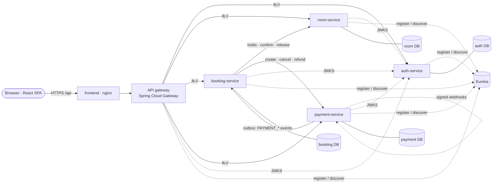

# GrandVista Hospitality — Inventory Control & Dynamic Room Reservation Platform

> University project **PS016** · SOA Programming and Microservices (**24SDCS03R**) · K L University
> GrandVista is a **fictional** hotel. All payments go through a **simulated** provider — no real money is ever moved.

A microservices hotel-booking platform: customers search live availability, see a transparent dynamic price,
reserve a room (which is **held** for 15 minutes), pay through a simulated provider and receive an
authoritative confirmation. Hotel staff manage inventory, room status, pricing policy, bookings and payments
from an administration dashboard.

The interesting part is the **distributed booking workflow**: a saga across three independently deployed
services with idempotent steps, compensations, an outbox, webhooks and a database-level guarantee that a room
can never be double-booked.

---

## Contents

1. [Features](#features) · 2. [Architecture](#architecture) · 3. [Technology](#technology) ·
4. [Repository layout](#repository-layout) · 5. [Quick start (Docker)](#quick-start-docker) ·
6. [Local development](#local-development-without-docker-for-the-services) · 7. [Configuration](#configuration) ·
8. [Tests](#tests) · 9. [URLs & ports](#urls-and-ports) · 10. [Accounts](#accounts) ·
11. [Troubleshooting](#troubleshooting) · 12. [Documentation](#documentation) · 13. [Known limitations](#known-limitations)

## Features

| Area | What is implemented |
|---|---|
| **Rooms & inventory** | Rooms, room types, amenities, photographs (validated uploads), operational status (active / maintenance / out of service / retired), search & filters, availability for `[checkIn, checkOut)`, calendar of booked nights, admin inventory views and audit trail |
| **Dynamic pricing** | Deterministic engine: base × weekend × season × demand (own occupancy), clamped to min/max, per-night breakdown, service fee and tax, `BigDecimal` HALF_UP rounding, versioned immutable policies, price snapshot stored with every booking |
| **Bookings** | Idempotent creation (`Idempotency-Key`), temporary inventory hold, authoritative price check, payment initiation, saga confirmation via payment events, cancellation policy (100% / 50% / 0%), auditable status history, recovery job for stuck/expired bookings |
| **Events & e-mail** | RabbitMQ topic exchange with transactional outboxes in booking and payment services, publisher confirms, per-consumer queues with dead-letter queues and retries; notification-service sends HTML e-mails (confirmation, payment receipt, cancellation, failed payment, expired hold), suppressing duplicates when an event is redelivered; captured locally by Mailpit |
| **Payments** | Explicit state machine, simulated provider behind a provider interface, idempotent charges, HMAC-signed timestamped webhooks with de-duplication, refunds (partial/full), reconciliation of timed-out charges, transactional outbox to the booking service |
| **Security** | RS256 JWT (JWKS), rotating refresh tokens in an HttpOnly SameSite=Strict cookie with reuse detection, BCrypt, account lockout, gateway rate limiting, CORS allow-list, roles (CUSTOMER / STAFF / ADMIN / SERVICE), ownership checks returning 404, service-to-service client credentials, no public admin creation |
| **Platform** | Spring Cloud Gateway, Eureka discovery + client-side load balancing, correlation IDs end-to-end, RFC 9457 problem responses, health/readiness probes, Prometheus metrics, Flyway migrations, Docker Compose, GitHub Actions CI |
| **Web app** | React + TypeScript: home, search, room details with live quote, register/sign-in, checkout, simulated payment, live confirmation, customer dashboard, booking details & cancellation, admin dashboard with charts, rooms editor, pricing, bookings, payments, users |

## Architecture



Each service owns its database: four separate PostgreSQL containers, each with its own credentials, volume and
health check (verified by `./scripts/verify-db-isolation.sh`). Detailed diagrams
(context, sequence, payment workflow, state machines, deployment) are in
[docs/architecture/ARCHITECTURE.md](docs/architecture/ARCHITECTURE.md).

## Technology

Java 21 · Spring Boot 3.5.16 · Spring Cloud 2025.0.3 (Gateway server-webflux, Netflix Eureka, LoadBalancer) ·
Spring Security / OAuth2 Resource Server · Spring Data JPA (Hibernate 6) · Flyway · PostgreSQL 16 ·
springdoc-openapi 2.8 · Micrometer/Prometheus · JUnit 5, Mockito, Testcontainers ·
React 19 · TypeScript 5.9 · Vite 7 · React Router 7 · TanStack Query 5 · React Hook Form + Zod 4 ·
Tailwind CSS 4 · Recharts 3 · Vitest + Testing Library + axe-core · Docker / Compose · GitHub Actions.

Why these choices: [docs/architecture/ARCHITECTURE.md §11](docs/architecture/ARCHITECTURE.md#11-technology-decisions).

## Repository layout

```
grandvista-hospitality/
├── frontend/                    React + TypeScript SPA (Vite), nginx Dockerfile
├── services/
│   ├── discovery-server/        Eureka registry (HTTP Basic protected)
│   ├── api-gateway/             Spring Cloud Gateway: routes, JWT pre-check, CORS, rate limits
│   ├── auth-service/            identity, JWT issuance (RS256 + JWKS), refresh tokens, roles
│   ├── room-service/            rooms, availability, holds/allocations, pricing, media
│   ├── booking-service/         reservations + saga orchestration, cancellation, recovery
│   └── payment-service/         payments, simulated provider, webhooks, refunds, outbox
├── shared/platform-commons/     correlation IDs, problem errors, JWT wiring, service clients, retry
├── contracts/                   inter-service message examples verified by provider & consumer tests
├── infrastructure/
│   ├── docker/postgres/init/    creates the four service databases and owner roles
│   └── secrets/                 generated JWT keys (git-ignored)
├── scripts/                     init-env.sh, reset-data.sh, e2e-smoke.sh, load-test.mjs, consistency-audit.mjs, generate-demo-media.mjs
├── docs/                        architecture, API, database, testing, deployment, security, report …
├── .github/workflows/ci.yml     CI pipeline
├── docker-compose.yml
└── .env.example
```

## Quick start (Docker)

**Prerequisites:** Docker Desktop (or Docker Engine) with Compose v2, ~4 GB of memory for Docker, `openssl`.

```bash
./scripts/init-env.sh
```
Generates `.env` (random database, Eureka, service-client and webhook secrets, and a bootstrap
administrator password) and an RSA key pair in `infrastructure/secrets/`. Both are git-ignored and never printed.

```bash
docker compose up -d --build
```
First build takes a few minutes (Maven and npm dependencies are cached afterwards). Services start in
dependency order using health checks; check progress with:

```bash
docker compose ps
```

Open **http://localhost:3000**. Verify the whole platform end to end (52 checks, ~40 s):

```bash
./scripts/e2e-smoke.sh
```

Logs (all services, or one):

```bash
docker compose logs -f --tail=100 booking-service
```

Stop (keeps data):

```bash
docker compose down
```

Reset **all data** (deletes the database and uploaded photos — irreversible; the script asks you to type `DELETE`):

```bash
./scripts/reset-data.sh
```

## Local development (without Docker for the services)

Run PostgreSQL in Docker and the services from your IDE or Maven:

```bash
docker compose up -d postgres
```
Each service reads `DB_PASSWORD` etc. from the environment; export the values from `.env` first
(`set -a; . ./.env; set +a`) and map them as documented in
[docs/deployment/DEPLOYMENT.md](docs/deployment/DEPLOYMENT.md#running-services-locally). Start order:
discovery-server → auth-service → room-service, payment-service → booking-service → api-gateway, e.g.

```bash
mvn -pl services/room-service -am spring-boot:run
```

Frontend with hot reload (proxies `/api` to the gateway on :8080):

```bash
npm --prefix frontend install && npm --prefix frontend run dev
```

## Configuration

All configuration is environment-based; see [.env.example](.env.example) for every variable and its meaning.
Secrets are never committed. Profiles: default (development: demo data and Swagger enabled) and `prod`
(disables Swagger and demo data, refuses ephemeral JWT keys and missing webhook secrets).

## Tests

| Suite | Command | Last verified result |
|---|---|---|
| Backend unit + integration + contract (Testcontainers PostgreSQL) | `mvn -B clean verify` | 148 tests, 0 failures, 0 errors, 0 skipped |
| Frontend unit + component + accessibility | `npm --prefix frontend test` | 24 tests, 0 failures |
| Frontend lint / types / build | `npm --prefix frontend run lint && npm --prefix frontend run build` | passing |
| End-to-end against the running stack | `./scripts/e2e-smoke.sh` | 52 checks passed |
| Load / contention | `node scripts/load-test.mjs` | 1,119 req/s, 0 errors; 10 concurrent bookings → 1 accepted ([details](docs/testing/TESTING.md#load-test-measured-single-laptop-all-services-in-docker-limits-raised)) |
| Booking consistency audit | `node scripts/consistency-audit.mjs` | 18 checks passed ([evidence](docs/testing/evidence/consistency-audit.txt)) |

Details, coverage of scenarios and the exact verification log: [docs/testing/TESTING.md](docs/testing/TESTING.md).

## URLs and ports

| What | URL | Notes |
|---|---|---|
| Web application | http://localhost:3000 | nginx serving the SPA and proxying `/api` |
| API gateway | http://localhost:8080/api/v1 | the only public API entry point |
| Swagger UI (all services) | http://localhost:8080/swagger-ui.html | development only (`API_DOCS_ENABLED`) |
| Eureka dashboard | http://localhost:8761 | loopback only, HTTP Basic (`EUREKA_USERNAME`/`EUREKA_PASSWORD` from `.env`) |
| PostgreSQL (one server per service) | auth 5433 · room 5434 · booking 5435 · payment 5436 · notification 5437 | loopback only, per-service credentials in `.env` |
| RabbitMQ management UI | http://localhost:15672 | loopback only, `RABBITMQ_USERNAME` / `RABBITMQ_PASSWORD` from `.env` |
| Mailpit (captured e-mails) | http://localhost:8025 | loopback only; every e-mail the platform sends lands here |
| Services (internal network only) | auth 8081 · room 8082 · booking 8083 · payment 8084 · notification 8085 | not published to the host |

## Accounts

* **Customers** register themselves in the web app (every self-registration is a `CUSTOMER`).
* **Administrator:** created once at start-up from `GV_BOOTSTRAP_ADMIN_EMAIL` / `GV_BOOTSTRAP_ADMIN_PASSWORD`
  (generated into `.env` by `init-env.sh` — read it there; it is never logged). It is only created when no
  administrator exists. There is no API or UI that lets an anonymous user create an administrator.
* **Demo accounts** (created when `GV_DEMO_SEED_ENABLED=true`): customer `guest@grandvista.local` and staff
  `staff@grandvista.local`; their passwords are generated into `.env` (`GV_DEMO_CUSTOMER_PASSWORD`,
  `GV_DEMO_STAFF_PASSWORD`). Disabled by the `prod` profile.
* **Staff:** an administrator grants the `STAFF` role under *Administration → Users & roles*.
* **Demo data:** 11 fictional rooms across 5 types are seeded on first start when `GV_DEMO_SEED_ENABLED=true`.
  Room images are labelled illustrations, not photographs.
* **Test payment methods** (simulated): `sim_card_success`, `sim_card_declined`, `sim_card_insufficient_funds`,
  `sim_card_async_success`, `sim_card_async_decline`, `sim_card_timeout_success`.

## Troubleshooting

| Symptom | Check |
|---|---|
| `docker compose up` says a variable is missing | run `./scripts/init-env.sh` |
| A service keeps restarting | `docker compose logs <service>`; database password mismatch after regenerating `.env` → reset volumes |
| Gateway returns 503 `SERVICE_UNAVAILABLE` | service not registered/UP in Eureka yet — wait ~30 s or see the dashboard |
| Login works but the session is lost on reload | the browser must accept the `Secure` refresh cookie; use `http://localhost` (not an IP) or HTTPS |
| 429 `RATE_LIMITED` during experiments | per-IP limits (`GV_API_RATE_LIMIT`, `GV_AUTH_RATE_LIMIT`) |

More (database, Eureka, routing, stuck holds, payments, migrations):
[docs/deployment/OPERATIONS.md](docs/deployment/OPERATIONS.md).

## Documentation

| Document | Contents |
|---|---|
| [Architecture](docs/architecture/ARCHITECTURE.md) | service boundaries, data ownership, saga, payment workflow, consistency, diagrams, decisions |
| [API reference](docs/api/API_REFERENCE.md) | every endpoint, roles, gateway routes, examples, errors |
| [Database](docs/database/DATABASE.md) | ER diagrams, table ownership, constraints, indexes, migrations |
| [Testing](docs/testing/TESTING.md) | strategy, commands, verified results, consistency audit, load test, responsive matrix ([raw evidence](docs/testing/evidence/)) |
| [Deployment](docs/deployment/DEPLOYMENT.md) · [Operations](docs/deployment/OPERATIONS.md) | Docker, configuration, cloud path, observability, diagnosis |
| [Security](docs/security/SECURITY.md) | threat model, controls, token strategy, residual risks |
| [Demonstration script](docs/DEMO_SCRIPT.md) | step-by-step live demo with curl commands |
| [Requirement traceability](docs/TRACEABILITY_MATRIX.md) | every requirement → code, tests, evidence, status |
| [Project report](docs/project-report/PROJECT_REPORT.md) | academic report for PS016 |

## Known limitations

* The payment provider is **simulated**; integrating a real provider means implementing `PaymentProvider`
  (and its webhook signature scheme). No real money or card data is ever handled.
* Gateway rate limiting is in-memory (correct for one gateway instance; use Redis-backed limiting for several).
* E-mails go to a local Mailpit inbox only; no real e-mail provider is configured.
* No cloud deployment has been performed (a deployment path is documented); the CI workflow has not been run on GitHub.
* Gateway and Eureka were run as single instances; multi-instance was verified for room-service only.
* Responsive layout verified by browser emulation at 375–1440 px, not on physical devices.
* Load figures come from one laptop and are not production capacity estimates.
* Full list with mitigations: [docs/PROJECT_CHECKLIST.md](docs/PROJECT_CHECKLIST.md) and the traceability matrix.
