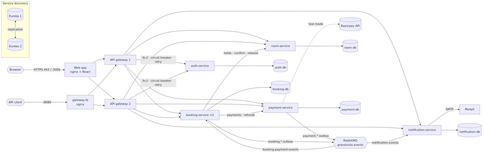

**Repository:** <https://github.com/maheswar-padi/grandvista-hospitality> (public) · **Status:** CI green ·
**Prepared by:** PADI SESHA MAHESWARA RAO · 23 Oct 2026

| # | Team member | Role |
|---|---|---|
| 1 | KOONI BHAVYA SREE | Team Lead |
| 2 | CHUNCHU PURVI SATHVIKA | Member |
| 3 | PADI SESHA MAHESWARA RAO | Member |

## 1. What the project is

GrandVista is a hotel reservation platform for a **fictional** chain of **3 hotels (Hyderabad, Goa, Dubai)**, built as **Spring Boot microservices**.
Customers search rooms for their dates in a city or hotel, see a **dynamic price** (weekend, season and demand multipliers, fee and
tax), reserve a room — it is **held for 15 minutes** — pay, and receive a confirmation and e-mails. Staff manage
each hotel's rooms, prices, bookings and payments in an admin dashboard, and a **stock reconciliation** job
checks every hotel's room allocations against the bookings. The core idea is a **distributed booking workflow (saga)**
across independent services that never sells the same room twice, never charges without a booking, and keeps
working when an instance fails. Payments use a **simulated** provider (Razorpay **test mode** is built in); no real
money ever moves.

{width=100%}

## 2. Services and tech stack

| Part | What it does |
|---|---|
| **api-gateway** (×2) + nginx load balancer | single entry point: routing, JWT check, CORS, rate limits, circuit breakers |
| **discovery-server** (×2, Eureka) | service registry; the two servers copy each other |
| **auth-service** | sign-up/login, RS256 JWT + refresh tokens, roles (customer, staff, admin) |
| **room-service** | hotels, rooms, availability, 15-minute holds, dynamic pricing, photos, stock reconciliation |
| **booking-service** (×2) | bookings and the saga: hold → payment → confirm, cancellations and refunds |
| **payment-service** | payment states, simulated provider / Razorpay test mode, webhooks, refunds |
| **notification-service** | turns events into e-mails (confirmation, receipt, cancellation, failed payment, expiry) |
| RabbitMQ · Mailpit · PostgreSQL ×5 | event bus with dead-letter queues · local e-mail inbox · one database per service |
| **frontend** | React 19 + TypeScript web app for customers and admins |

**Stack:** Java 21, Spring Boot 3.5, Spring Cloud 2025.0 (Gateway, Eureka, LoadBalancer), Resilience4j, Spring
Security (JWT), JPA + Flyway, PostgreSQL 16, RabbitMQ 4.1, Thymeleaf; React 19, TypeScript, Vite, Tailwind;
JUnit 5, Testcontainers, JaCoCo, Vitest, k6; Docker Compose (19 containers, 21 with Prometheus + Grafana); GitHub Actions.

## 3. How to run it

Needs Docker with about **4 GB of memory**, plus `openssl`, `curl`, `jq`. From the repository folder:

```
./scripts/start.sh        # creates .env + keys if missing, builds, starts and waits (first run: several minutes)
./scripts/e2e-smoke.sh    # 70 end-to-end checks against the running stack
```

| URL | What |
|---|---|
| http://localhost:3000 | web app |
| http://localhost:8080/api/v1 · /swagger-ui.html | API (2 gateways) · Swagger |
| http://localhost:8761 · :8762 | Eureka 1 · Eureka 2 |
| http://localhost:15672 · http://localhost:8025 | RabbitMQ UI · Mailpit (all e-mails) |

**Demo logins** (created automatically; every password is generated into your own `.env` and never committed):

| Role | E-mail | Password in `.env` |
|---|---|---|
| Administrator | `admin@grandvista.local` | `GV_BOOTSTRAP_ADMIN_PASSWORD` |
| Customer | `guest@grandvista.local` | `GV_DEMO_CUSTOMER_PASSWORD` |
| Staff | `staff@grandvista.local` | `GV_DEMO_STAFF_PASSWORD` |

Other useful commands: `./scripts/failover-demo.sh` (kills instances while booking), `./scripts/load-test-k6.sh`,
`docker compose down` (stop, keep data). Simulated test card: **Simulated Visa – approved**.

## 4. Verified results (real runs)

| Check | Result |
|---|---|
| GitHub Actions CI (run 39907254564, clean runner) | **all jobs green**, ~9 min: 214 backend tests (87.9 % lines), 34 frontend tests, e2e 70/70 |
| Backend tests (unit, integration with real PostgreSQL/RabbitMQ/Mailpit) | **214 tests, 0 failures** |
| Code coverage (JaCoCo, local 23 Oct) | **88.6 % of lines, 67.7 % of branches** |
| Frontend (lint, types, tests incl. accessibility, build) | **34 tests**, all passing |
| End-to-end smoke test on the full stack (local 23 Oct) | **70/70** (incl. 4 e-mails, hotel search, live reconciliation) |
| Database isolation (5 servers) | **40/40** |
| Failover: kill a gateway, a Eureka server, a booking replica (local) | run A 99/100 requests, run B 100/100; **all 8 bookings completed** |
| k6 load test, 20 users (local laptop) | 0 % errors; search p95 135.9 ms, quote p95 60.8 ms |
| 10 customers book the same room at the same moment | **1 accepted, 9 refused** — no double booking |

## 5. Done vs. future work

**Done:** microservices with database per service · gateway + Eureka, both doubled · saga with compensations and
recovery · dynamic pricing · RabbitMQ events with outboxes and dead-letter queues · e-mail notifications · JWT
security and roles · 3-hotel portfolio (search by city/hotel, per-hotel pricing and admin) · stock reconciliation with
automatic release of expired orphan holds · simulated payments + Razorpay test-mode code · resilience (circuit breakers, retries) ·
React web app with admin dashboard · 248 automated tests, CI green · documentation, report draft, demo script.

**Not done / future work:** Razorpay never run against Razorpay's real test API (needs test keys) · no cloud
deployment yet (prepared for an Oracle Cloud free VM with HTTPS) · e-mails go to Mailpit only · auth, room,
payment, notification, RabbitMQ and databases run as single instances · rate limits are per gateway · all hotels price in INR and staff are not limited to one hotel · report
placeholders: department/guide details, review dates, declaration/certificate pages, acknowledgement, 14 screenshots.

## 6. Suggested split for the reviews

| Review | Focus | Show / prepare |
|---|---|---|
| **Review 1** — design | problem, objectives, architecture, service boundaries, database per service, API design | architecture diagram, ER diagrams (`docs/database`), Swagger, `docker compose ps`, report §1–§14 |
| **Review 2** — working system | booking saga, dynamic pricing, payments, events and e-mails, security | live demo: search by city/hotel → book → pay → confirmation → e-mail in Mailpit; admin hotel filter and Reconciliation page; RabbitMQ queues; report §15–§20 (portfolio and reconciliation: §16.1–16.2) |
| **Final Review** — quality and operations | testing, high availability, CI/CD, deployment, results, limitations | failover demo, CI run and badge, coverage, k6 results, report §21–§27, all screenshots and team details filled in |

Suggested ownership (adjust as a team): **member 1** — backend services and saga; **member 2** — frontend and
demo walkthrough; **member 3** — testing, CI and the report. Everyone should be able to run `./scripts/start.sh`
and explain the architecture diagram.

**Start here:** `README.md` → `docs/DEMO_SCRIPT.md` (7–10 min demo and screenshot list) →
`docs/project-report/PROJECT_REPORT.md` → `docs/TRACEABILITY_MATRIX.md`.
