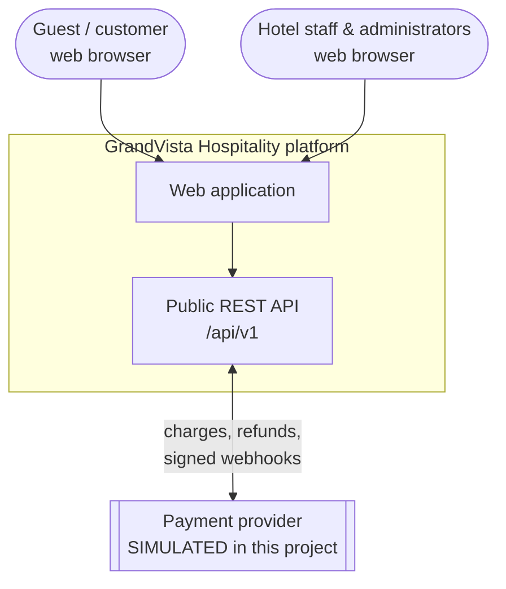
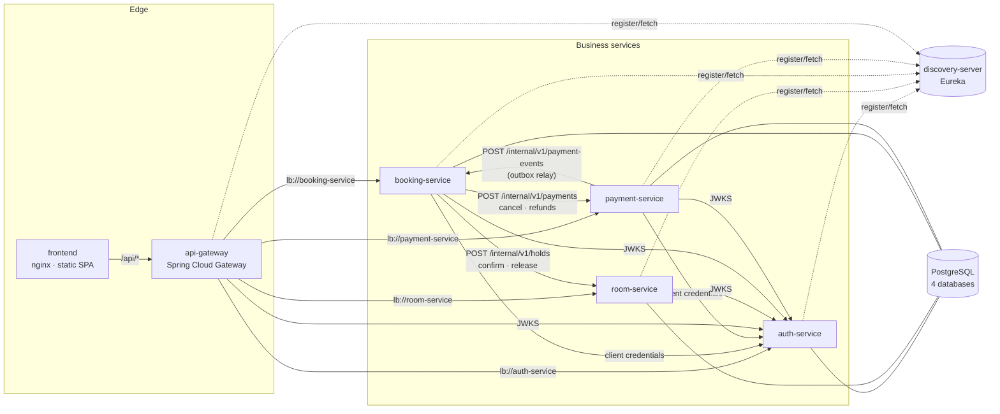
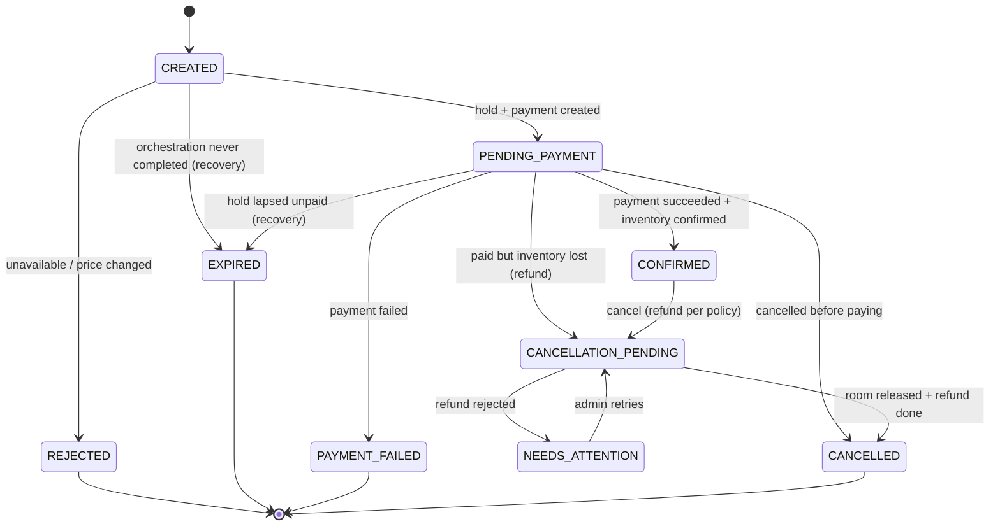
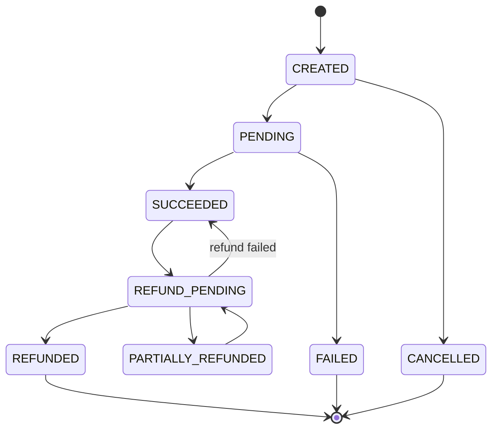
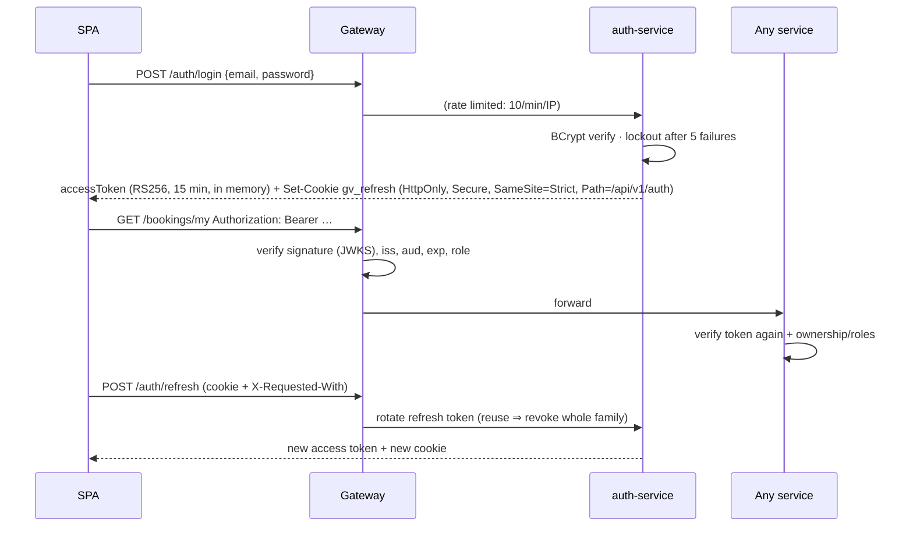

# Architecture

This document describes the system **as implemented**. Everything described here exists in the repository and
is exercised by the tests listed in [TESTING.md](../testing/TESTING.md).

## 1. System context



The platform has no external dependencies at runtime other than its own PostgreSQL servers (one per service). The payment
provider is simulated inside the payment-service (clearly separated in its own schema and package) so the
complete workflow — including asynchronous webhooks and lost responses — can be demonstrated without
credentials or real money.

## 2. Service architecture



| Component | Responsibility | Owns |
|---|---|---|
| **frontend** | React SPA; nginx serves it and reverse-proxies `/api` so the browser sees one origin | — |
| **api-gateway** | Single public entry point: explicit routes over Eureka (`lb://`), JWT pre-validation, coarse role checks, CORS, per-IP rate limiting, request-size limit, correlation IDs, uniform problem errors, aggregated Swagger UI | — |
| **discovery-server** | Eureka registry (HTTP Basic protected); services register, gateway and services discover each other | — |
| **auth-service** | Registration, login, account lockout, RS256 access tokens + JWKS, rotating refresh tokens, roles, user administration, client-credentials tokens for services, bootstrap administrator | `grandvista_auth` |
| **room-service** | Room catalogue, room types, amenities, photos (media store), search & availability, **inventory holds/allocations**, **dynamic pricing** and policy versions, inventory audit trail, occupancy statistics | `grandvista_room` |
| **booking-service** | Reservations and their lifecycle; **orchestrates the booking saga**; cancellation policy; payment-event inbox; recovery of stuck bookings | `grandvista_booking` |
| **payment-service** | Payments and their state machine, provider abstraction + simulated provider, idempotent charges, webhooks, refunds, reconciliation, **transactional outbox** | `grandvista_payment` |
| **platform-commons** | Shared library (not a service): correlation-ID filter, RFC 9457 errors, JWT validation wiring, service-token client, bounded retry, specification helpers. Contains no business logic. | — |

### Decision ownership

| Decision | Owner | Why there |
|---|---|---|
| Is the room free for these dates? | room-service | it owns allocations and the exclusion constraint |
| What does the stay cost? | room-service | it owns base rates, pricing policy and occupancy |
| May this customer book / cancel, and what is refunded? | booking-service | it owns reservations and the cancellation policy |
| Did the money move? | payment-service (from the provider) | only the provider's answer is authoritative |
| Who is the caller and what are their roles? | auth-service (token issuer); every service verifies | central identity, decentralised enforcement |

## 3. Synchronous communication

* **Discovery & load balancing.** Services register with Eureka (`eureka.client.healthcheck.enabled=true`, so
  an instance whose database is down is reported DOWN and skipped). Callers use Spring Cloud LoadBalancer
  through a `@LoadBalanced RestClient.Builder` with logical URLs such as `http://room-service`. The gateway uses
  `lb://` route URIs. Route targets can be overridden with direct URLs (`GV_ROUTE_*`) for runs without Eureka.
* **Timeouts.** Every outbound call has explicit connect/read timeouts (2 s / 5–8 s); gateway: 2 s connect,
  15 s response.
* **Retries.** `platform-commons` `Retrier`: at most 3 attempts, exponential backoff with ±20% jitter, only for
  transport failures and 502/503/504, and **only for operations that are idempotent on the callee** (every
  internal command carries a booking id, payment id or idempotency key). 4xx responses are never retried.
* **Contracts.** Each consumer declares its own DTOs (no shared entity classes). Example messages in
  [`/contracts`](../../contracts) are verified by both provider and consumer tests. Internal APIs are versioned
  under `/internal/v1`, public APIs under `/api/v1`; the payment event carries `schemaVersion`.
* **Service authentication.** booking-service and payment-service obtain short-lived (5 min) `SERVICE` tokens
  from the auth-service with the client-credentials grant; `/internal/**` endpoints require that role.
  `/internal/**` is never routed by the gateway.
* **Correlation.** The gateway assigns `X-Correlation-Id`; every service puts it in the logging MDC, returns it,
  forwards it on outbound calls and stores it with outbox events, so one request can be followed through all
  logs (verified: the same ID appears in gateway, booking-service and room-service logs).

## 4. Asynchronous communication

Payment outcomes reach the booking-service **asynchronously** through a **transactional outbox**:

1. When a payment becomes `SUCCEEDED` or `FAILED`, the payment-service writes an `outbox_events` row **in the
   same transaction** as the state change — the event can't be lost or published for a rolled-back change.
2. `OutboxRelay` (every 2 s) claims one due event with `FOR UPDATE SKIP LOCKED`, POSTs it to
   `booking-service /internal/v1/payment-events`, and marks it `SENT`. Failures back off exponentially (2 s …
   5 min); a 4xx (contract rejection) dead-letters the event; after 25 attempts the event is `DEAD` and shows
   on the admin dashboard.
3. The booking-service consumer is **idempotent**: it records processed event ids in `processed_events`
   inside the same transaction as the booking transition; duplicates return `DUPLICATE`.

**Why not RabbitMQ/Kafka?** At-least-once delivery between two services is fully provided by the outbox +
HTTP relay + idempotent consumer, without adding a broker to operate (and to fit in a laptop's memory). The
relay is isolated in one class, so swapping HTTP for a broker publisher is a contained change; this is listed
as a future enhancement.

## 5. Booking orchestration (saga)

The booking-service orchestrates; there is no distributed transaction. Each local step is a short database
transaction under a row lock, remote calls happen between transactions, and every remote step is idempotent.

```mermaid
sequenceDiagram
  autonumber
  actor C as Customer (SPA)
  participant G as API gateway
  participant B as booking-service
  participant R as room-service
  participant P as payment-service
  participant S as Simulated provider

  C->>G: POST /api/v1/bookings (JWT, Idempotency-Key, expectedTotal)
  G->>B: route (JWT pre-validated)
  B->>B: validate dates/guests; insert booking CREATED<br/>(unique customer + key ⇒ replay returns same booking)
  B->>R: POST /internal/v1/holds {bookingId, room, dates}
  R->>R: lock room row; expire stale holds; price stay;<br/>INSERT allocation HELD (exclusion constraint)
  R-->>B: 201 hold + authoritative quote (expires in 15 min)
  alt quote.total ≠ expectedTotal
    B->>R: release hold
    B-->>C: 409 PRICE_CHANGED (no charge)
  end
  B->>B: store immutable price snapshot
  B->>P: POST /internal/v1/payments {bookingId, amount, expiresAt}
  P-->>B: 201 payment CREATED
  B->>B: CREATED → PENDING_PAYMENT
  B-->>C: 201 booking PENDING_PAYMENT (+ paymentId, holdExpiresAt)

  C->>G: POST /api/v1/payments/{id}/confirm (Idempotency-Key, test token)
  G->>P: route
  P->>P: owner check; CREATED → PENDING (tx 1)
  P->>S: charge(idempotencyKey = paymentId)
  S-->>P: SUCCEEDED / FAILED / PENDING
  P->>P: apply outcome + outbox event (tx 2)
  P-->>C: payment status
  loop every 2 s
    P->>B: POST /internal/v1/payment-events PAYMENT_SUCCEEDED
  end
  B->>R: POST /internal/v1/holds/{bookingId}/confirm
  R-->>B: allocation CONFIRMED
  B->>B: PENDING_PAYMENT → CONFIRMED (+ processed event)
  C->>G: GET /api/v1/bookings/{id} (polling)
  G-->>C: CONFIRMED (authoritative)
```

### Failure handling and compensation

| Situation | What happens | Customer impact |
|---|---|---|
| Room unavailable / not sellable / too many guests | hold refused (409/422) → booking `REJECTED` | clear error, never charged |
| Price changed since the customer's quote | hold released → `REJECTED` with `PRICE_CHANGED` | shown the new price, never charged |
| room-service or payment-service unreachable during creation | booking stays `CREATED`, 503 with `retryable=true`; retrying with the same key **resumes** (hold/payment creation are idempotent); otherwise the recovery job releases the hold, voids any payment and marks `EXPIRED` | never charged |
| Payment declined | `PAYMENT_FAILED` event → room released → booking `PAYMENT_FAILED` | told it failed, room freed |
| Customer never pays | after the hold expiry the recovery job voids the payment (only possible while `CREATED`), releases the room, booking `EXPIRED` | nothing charged |
| Payment succeeded but hold had expired | room-service tries to **re-acquire** the same dates; if still free → confirmed | booking confirmed |
| …and someone else took the room meanwhile | `INVENTORY_NO_LONGER_AVAILABLE` → booking `CANCELLATION_PENDING` with full refund → refund issued → `CANCELLED` | full refund, told why |
| Refund rejected by the provider | booking `NEEDS_ATTENTION` (visible on the dashboard); admin can *Retry compensation* | handled by staff |
| Payment event delivery fails (booking/room service down) | outbox retries with backoff; booking consumer is idempotent | confirmation delayed, not lost |
| Payment event lost entirely | recovery job's void attempt returns `PAYMENT_ALREADY_CAPTURED` → booking confirmed via the normal success path | confirmation delayed |
| Provider response lost after charging (timeout) | payment stays `PENDING`; reconciliation job asks the provider (`retrieve`) and applies the authoritative outcome | confirmation delayed |
| Duplicate client request / double click | same `Idempotency-Key` ⇒ same booking/payment attempt; provider idempotency key = payment id ⇒ never charged twice | none |
| Duplicate webhook | de-duplicated by provider event id | none |

### Booking state machine



Transitions are enforced by `BookingStatus.canTransitionTo` and applied only through `Booking.transitionTo`,
which also appends to `booking_status_history`. There is no endpoint that sets a status directly.

**Cancellation policy** (hotel-local calendar days before check-in): ≥ 7 days → 100% refund; 2–6 days → 50%;
fewer → no refund (still cancellable until the check-in date); on/after check-in → not cancellable online.
Cancellations by staff/administrators on a guest's booking are hotel-initiated → 100% refund.

## 6. Payment workflow

```mermaid
flowchart TD
  A[Booking created] -->|POST /internal/v1/payments| B[Payment CREATED<br/>amount fixed from price snapshot]
  B -->|customer confirms with test token<br/>+ Idempotency-Key| C{owner? not expired?<br/>status CREATED?}
  C -- no --> X[404 / 409 PAYMENT_EXPIRED /<br/>PAYMENT_ALREADY_PROCESSED]
  C -- yes --> D[PENDING · attempt recorded · tx committed]
  D -->|charge, key = paymentId| E{provider answer}
  E -- SUCCEEDED --> F[SUCCEEDED + outbox PAYMENT_SUCCEEDED]
  E -- FAILED --> G[FAILED + outbox PAYMENT_FAILED]
  E -- PENDING --> H[stays PENDING]
  E -- timeout --> H
  H -->|signed webhook<br/>HMAC + timestamp + dedupe| E2{event type}
  H -->|reconciliation job<br/>provider.retrieve| E2
  E2 -- charge.succeeded --> F
  E2 -- charge.failed --> G
  B -->|booking expired/cancelled before payment| V[CANCELLED (voided)]
  F -->|refund requested by booking-service| RP[REFUND_PENDING]
  RP --> RF[REFUNDED / PARTIALLY_REFUNDED]
  RP -->|provider refused| F
```



Key rules: the amount is set by the booking-service from the stored price snapshot and the confirm request has
no amount field (extra fields are ignored); a browser can never mark a payment successful — only the provider
response, a verified webhook or reconciliation can; there is no administrative endpoint that changes a payment
status (`/api/v1/admin/payments/**` is read-only and any write is denied).

## 7. Inventory consistency

Double booking is prevented by the database, not by application checks:

```sql
CONSTRAINT ex_allocations_no_overlap EXCLUDE USING gist (room_id WITH =, stay_range WITH &&)
    WHERE (status IN ('HELD', 'CONFIRMED'))
```

`stay_range` is a generated `daterange(check_in, check_out, '[)')` — the half-open interval means the check-out
day is free for the next guest. Additional safeguards:

* **Per-room serialisation.** A hold (and a confirm that may re-acquire) first takes `SELECT … FOR UPDATE` on
  the room row. Without it, two transactions inserting conflicting rows into a GiST exclusion constraint can
  wait on each other and be aborted as a deadlock (observed in testing); with it the loser waits and then gets
  a clean `ROOM_UNAVAILABLE`. Holds on *different* rooms proceed in parallel. Lock order is always room → allocation.
* **Holds expire.** A hold carries `hold_expires_at`; a sweeper (every 30 s, `SKIP LOCKED`) marks lapsed holds
  `EXPIRED`, and a new hold lazily expires stale holds on its own dates first.
* **Idempotency.** `booking_id` is unique per allocation, so retried holds return the original hold and price.
* **Status changes.** Administrators change room status under the same row lock; non-`ACTIVE` rooms cannot be
  held; retiring a room with upcoming confirmed stays is refused.
* **Optimistic locking** (`@Version`) protects concurrent edits of rooms, bookings and payments.

Verified by tests: 8 concurrent overlapping holds → exactly 1 succeeds; back-to-back stays both succeed; and,
through the full stack, 10 customers booking the same room at once → 1 accepted, 9 refused.

## 8. Dynamic pricing

```
rawNightly  = basePrice × dayMultiplier(weekend) × seasonMultiplier × demandMultiplier(room-type occupancy)
nightlyRate = round2( clamp(rawNightly, basePrice × minFactor, basePrice × maxFactor) )
subtotal    = Σ nightlyRate          serviceFee = round2(subtotal × feeRate)
taxes       = round2((subtotal + serviceFee) × taxRate)            total = subtotal + serviceFee + taxes
```

`BigDecimal` throughout, HALF_UP to 2 decimals at the points shown. Demand uses the hotel's **own** occupancy
for the room type on each night (held + confirmed allocations ÷ sellable rooms) — no external market data is
claimed. Policies are immutable versions (`pricing_policies`); exactly one is active (partial unique index);
publishing archives the previous one under a row lock. Quotes state the policy version and validity. The quote
shown in the browser is informational; the **hold** re-prices authoritatively, the booking compares it with the
customer's `expectedTotal`, and the agreed price is stored as an immutable snapshot.

## 9. Authentication architecture



Details and trade-offs: [SECURITY.md](../security/SECURITY.md).

## 10. Deployment architecture

```mermaid
flowchart TB
  subgraph host[Docker host]
    direction TB
    subgraph net[network: grandvista]
      fe[frontend :8080]
      gw[api-gateway :8080]
      ds[discovery-server :8761]
      au[auth-service :8081]
      ro[room-service :8082]
      bo[booking-service :8083]
      pa[payment-service :8084]
      pg[(postgres :5432)]
    end
    v1[(volume: postgres-data)]
    v2[(volume: room-media)]
    sec[/infrastructure/secrets: JWT keys (read-only)/]
  end
  user([Browser]) -->|:3000| fe
  user -->|:8080 API / Swagger| gw
  admin([Operator]) -->|127.0.0.1:8761| ds
  pg --- v1
  ro --- v2
  au --- sec
```

Start order is enforced by health checks (`depends_on: condition: service_healthy`): postgres → discovery →
auth → room & payment → booking → gateway → frontend. All Java containers run as a non-root user with memory
limits, `/actuator/health/readiness` health checks and rotated logs. Cloud options:
[DEPLOYMENT.md](../deployment/DEPLOYMENT.md#cloud-deployment).

## 11. Technology decisions

| Decision | Rationale | Alternatives considered |
|---|---|---|
| Spring Boot **3.5** + Spring Cloud **2025.0** | Directive requires Boot 3.x; 2025.0 is the matching release train (verified by build) | Boot 4 (not 3.x) |
| Gateway **server-webflux** | Current Spring Cloud Gateway artifact; non-blocking edge; `spring.cloud.gateway.server.webflux.*` properties verified against the jar metadata | Gateway MVC |
| **RS256 + JWKS** | Only the auth-service can sign; others verify with the public key; keys rotate without redeploying services | HS256 shared secret (every service could mint tokens) |
| Refresh token in **HttpOnly cookie**, access token **in memory** | Tokens unreadable by injected script; short access lifetime; CSRF closed by SameSite=Strict + required header | localStorage (XSS-exposed); cookie-only session (needs full CSRF tokens) |
| **PostgreSQL exclusion constraint** | Correct under any concurrency, for every code path | application check-then-insert (racy), Redis locks (extra infra, still racy on failure) |
| **Outbox + HTTP relay** | At-least-once without operating a broker | RabbitMQ/Kafka (more infrastructure for two services) |
| **Orchestrated saga** in booking-service | One place to read the workflow and its compensations | Choreography (logic spread across services) |
| Flyway, `ddl-auto=validate` | Explicit, reviewed schema; startup fails if code and schema diverge (caught two type mismatches during development) | Hibernate auto DDL |
| Specifications for optional filters | `(:p IS NULL OR …)` JPQL fails in PostgreSQL for null dates/UUIDs (found in live testing); specifications add only present predicates | native SQL per combination |
| Virtual threads (`spring.threads.virtual.enabled`) | Cheap blocking I/O for many concurrent requests on servlet services | larger platform-thread pools |
