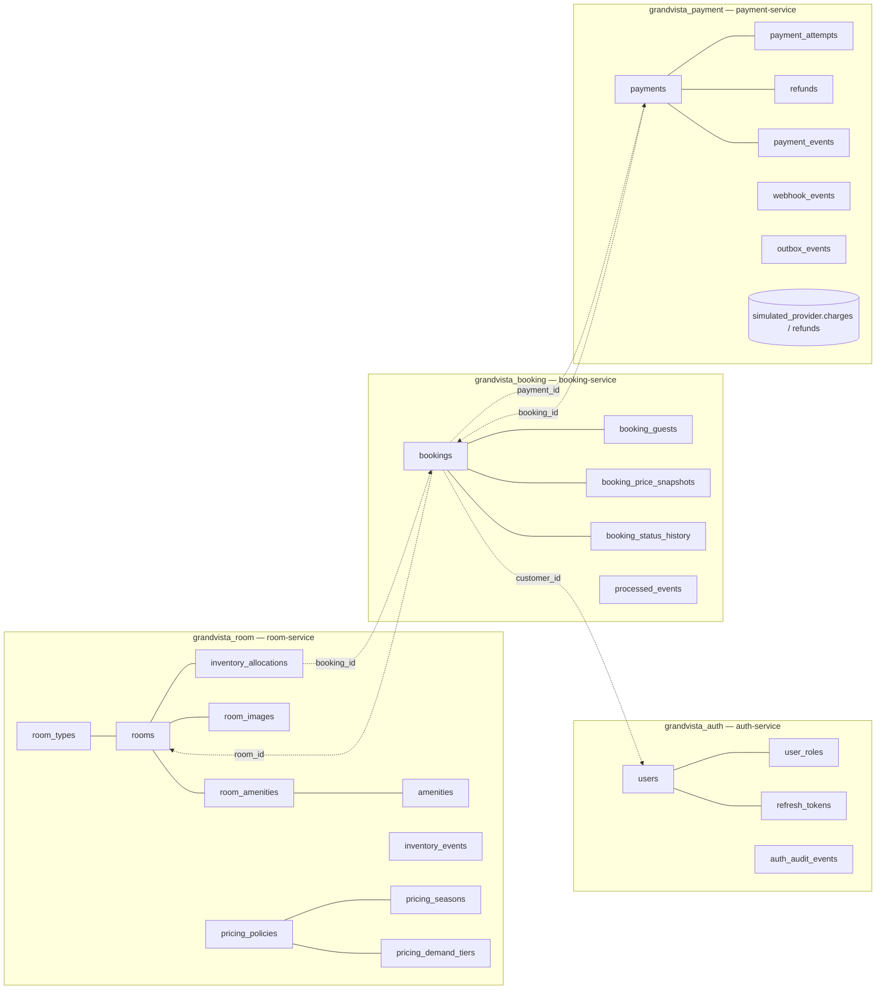
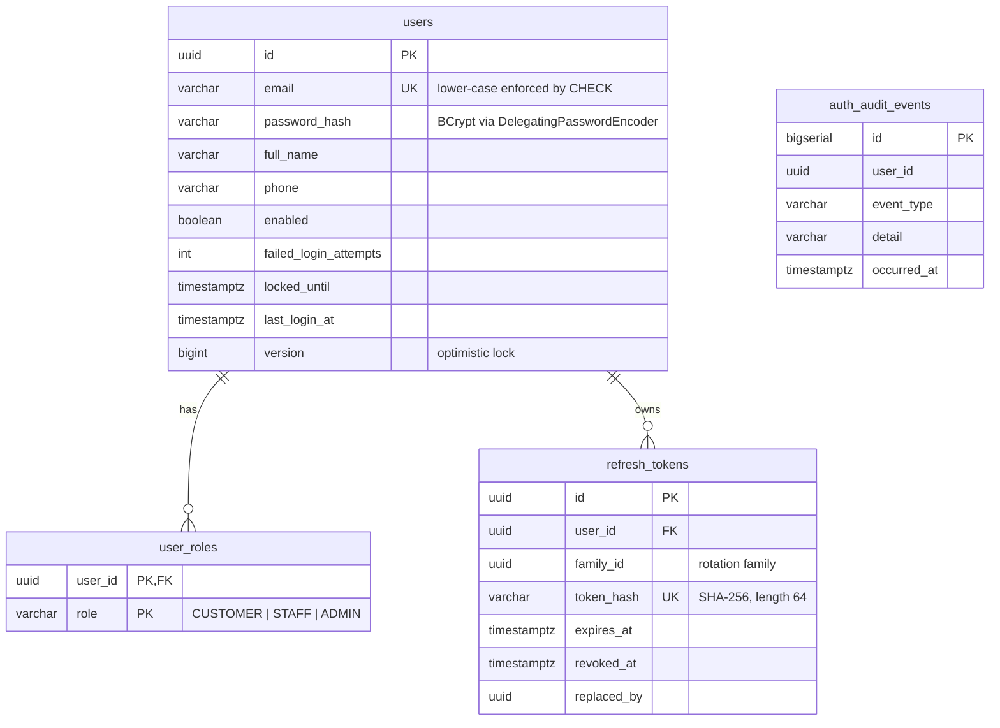
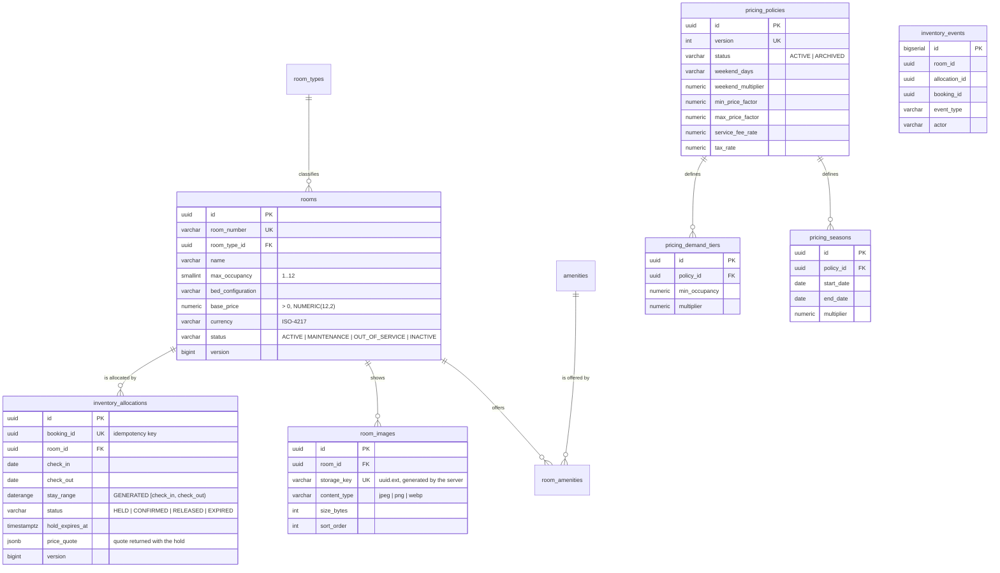
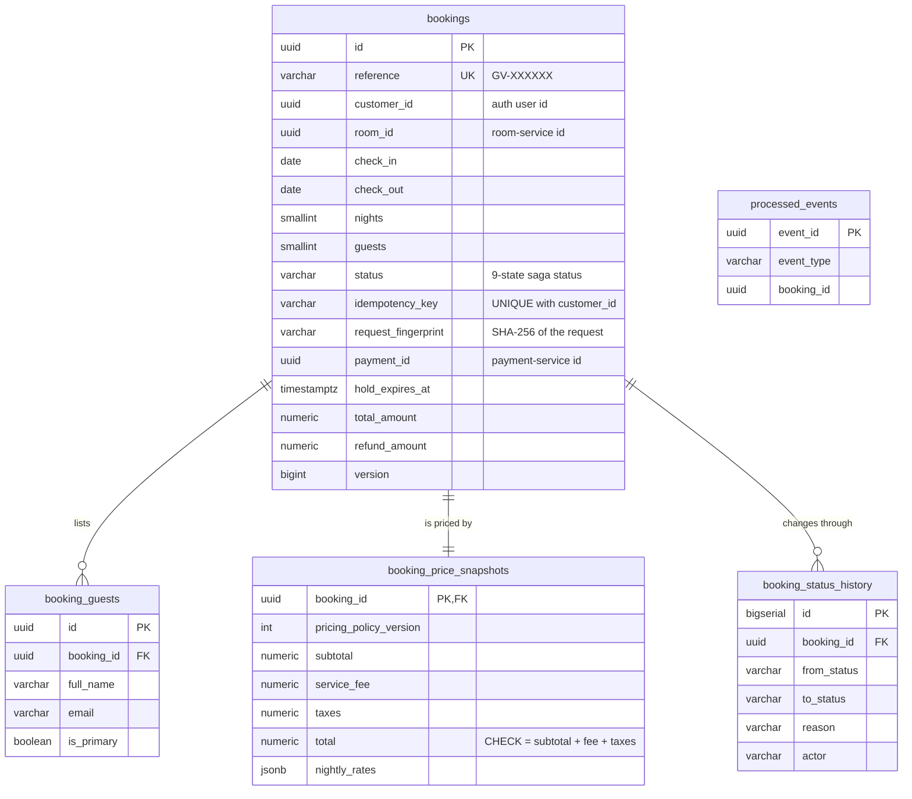
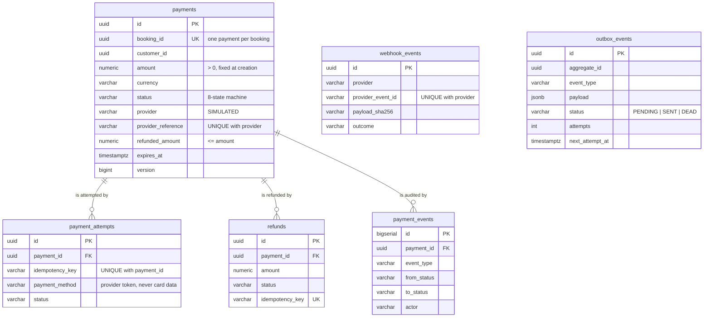

# Database design

One PostgreSQL 16 server hosts **four databases, one per service**, each owned by its own login role
(`grandvista_auth`, `grandvista_room`, `grandvista_booking`, `grandvista_payment`) created by
`infrastructure/docker/postgres/init/01-create-service-databases.sh`. A service's credentials can't read another
service's database, so there are **no cross-service foreign keys**: references across services are plain UUID
columns, and the copies a service keeps (e.g. room name on a booking) are deliberate snapshots.

The schema is created only by **Flyway migrations** (`services/<svc>/src/main/resources/db/migration`); Hibernate
runs with `ddl-auto=validate`, so a service refuses to start if code and schema disagree. All timestamps are
`TIMESTAMPTZ` stored in UTC; stay dates are `DATE` in the hotel's zone; money is `NUMERIC(12,2)`.

## 1. Ownership overview



Dotted arrows are logical references by id only (no database constraint, different databases).

## 2. auth-service (`V1__identity_schema.sql`)



| Table | Purpose | Notable constraints / indexes |
|---|---|---|
| `users` | accounts | `UNIQUE(email)`, `CHECK(email = lower(email))`, `failed_login_attempts >= 0` |
| `user_roles` | roles per user | PK `(user_id, role)`, `CHECK role IN (…)` (no SERVICE role for people) |
| `refresh_tokens` | hashed rotating refresh tokens | `UNIQUE(token_hash)`, indexes on `family_id`, `user_id`, `expires_at`; nightly purge job |
| `auth_audit_events` | logins, failures, lockouts, reuse detection, role changes | index `(user_id, occurred_at DESC)`; never stores passwords or tokens |

## 3. room-service (`V1__room_inventory_schema.sql`, `V2__reference_data.sql`)



| Table | Purpose | Notable constraints / indexes |
|---|---|---|
| `room_types`, `amenities` | reference data (seeded by `V2`) | unique `code` |
| `rooms` | inventory items | unique `room_number`; `CHECK` occupancy, price > 0, status set, currency pattern; indexes on type, `(status, base_price)`, occupancy |
| `room_amenities` | many-to-many | PK `(room_id, amenity_id)`, index on `amenity_id` |
| `room_images` | metadata of images in the media store (binaries are **not** in the database) | unique `storage_key`, content-type `CHECK`, index `(room_id, sort_order)` |
| `inventory_allocations` | holds and confirmed stays | **`EXCLUDE USING gist (room_id WITH =, stay_range WITH &&) WHERE (status IN ('HELD','CONFIRMED'))`**; `UNIQUE(booking_id)`; `CHECK(check_out > check_in)`; `CHECK(status <> 'HELD' OR hold_expires_at IS NOT NULL)`; GiST index `(room_id, stay_range)`; partial index on `hold_expires_at WHERE status='HELD'` for the expiry sweep |
| `inventory_events` | append-only audit of catalogue and inventory changes | indexes `(room_id, occurred_at DESC)`, `booking_id` |
| `pricing_policies` | immutable policy versions | `UNIQUE(version)`; **partial unique index on `status` WHERE `status='ACTIVE'`** (exactly one active policy); factor and rate `CHECK`s |
| `pricing_seasons`, `pricing_demand_tiers` | policy rules | `CHECK(end_date >= start_date)`; `UNIQUE(policy_id, min_occupancy)` |

`btree_gist` (a trusted extension) is created by the migration; it lets a GiST index combine `uuid =` with
`daterange &&`.

## 4. booking-service (`V1__booking_schema.sql`)



| Table | Purpose | Notable constraints / indexes |
|---|---|---|
| `bookings` | reservations | `UNIQUE(reference)`; **`UNIQUE(customer_id, idempotency_key)`** (duplicate submissions map to one booking); `CHECK(check_out > check_in)`; status `CHECK`; `CHECK(refund_amount <= total_amount)`; indexes `(customer_id, check_in DESC)`, `(status, updated_at)` (recovery job), `check_in`, `payment_id` |
| `booking_guests` | guest details | partial unique index: one primary guest per booking |
| `booking_price_snapshots` | immutable agreed price (`@Immutable` entity) | `CHECK(total = subtotal + service_fee + taxes)` |
| `booking_status_history` | every lifecycle transition with actor and reason | index `(booking_id, occurred_at)` |
| `processed_events` | inbox for payment events (at-least-once ⇒ exactly-once effect) | PK `event_id` |

## 5. payment-service (`V1__payment_schema.sql`)



| Table | Purpose | Notable constraints / indexes |
|---|---|---|
| `payments` | payment intents | `UNIQUE(booking_id)`, `UNIQUE(provider, provider_reference)`, `CHECK(refunded_amount <= amount)`, status `CHECK`; indexes `(customer_id, created_at DESC)`, `(status, updated_at)` (reconciliation) |
| `payment_attempts` | each customer confirmation | **`UNIQUE(payment_id, idempotency_key)`** |
| `refunds` | refunds requested by the booking-service | **`UNIQUE(idempotency_key)`** |
| `payment_events` | audit trail of every transition | index `(payment_id, occurred_at)` |
| `webhook_events` | receipts of verified callbacks | **`UNIQUE(provider, provider_event_id)`** (duplicate deliveries) |
| `outbox_events` | transactional outbox | partial index on `next_attempt_at WHERE status='PENDING'`; relay claims with `FOR UPDATE SKIP LOCKED` |
| `simulated_provider.charges`, `.refunds` | the **simulated** provider's own records (separate schema, clearly labelled) | unique idempotency keys and references |

No table stores card numbers, CVVs or other card authentication data — only provider token names and references.

## 6. Important design choices

* **Database-enforced invariants.** No double booking (exclusion constraint), one active pricing policy (partial
  unique index), one payment per booking, one allocation per booking, one booking per customer idempotency key,
  one receipt per webhook event, refund ≤ captured amount, snapshot total = sum of parts. Application checks give
  friendly errors; the database is the guarantee.
* **Half-open stays.** `daterange(check_in, check_out, '[)')` makes back-to-back stays legal without special cases.
* **Holds are rows, not timers.** `hold_expires_at` + a sweeper (`FOR UPDATE SKIP LOCKED`) + lazy expiry on new
  holds means expiry survives restarts and is safe with several instances (verified by
  `HoldExpirySchedulingIntegrationTest`).
* **Snapshots over joins across services.** A booking keeps the room name/number and the full price breakdown it
  was sold with, so later catalogue or pricing changes never alter it.
* **Optimistic locking** (`version`) on rooms, users, bookings, payments; **pessimistic row locks** only for short
  critical sections (room during hold/confirm/status change, booking during a saga step, payment during a
  transition, refresh token during rotation).
* **Indexes follow the queries:** search (status/price/type/occupancy), availability (GiST on room + range),
  sweeps (partial indexes on due work), customer history, admin filters.

## 7. Migrations

| Service | Migrations | Content |
|---|---|---|
| auth | `V1__identity_schema.sql` | users, roles, refresh tokens, auth audit |
| room | `V1__room_inventory_schema.sql`, `V2__reference_data.sql` | schema + 5 room types, 15 amenities, pricing policy v1 with seasons and demand tiers |
| booking | `V1__booking_schema.sql` | bookings, guests, snapshots, history, inbox |
| payment | `V1__payment_schema.sql` | payments, attempts, refunds, audit, webhooks, outbox, simulated provider schema |

Migrations run automatically at service start-up (`spring.flyway.enabled=true`). Add a change as a new
`V<n>__description.sql` file; never edit an applied migration (Flyway validates checksums). Demo rooms are **not**
a migration — they come from `DemoDataSeeder` (only when `GV_DEMO_SEED_ENABLED=true` and the catalogue is empty).
To inspect a database locally:

```bash
set -a; . ./.env; set +a; PGPASSWORD=$ROOM_DB_PASSWORD psql -h localhost -p 5433 -U grandvista_room grandvista_room
```
