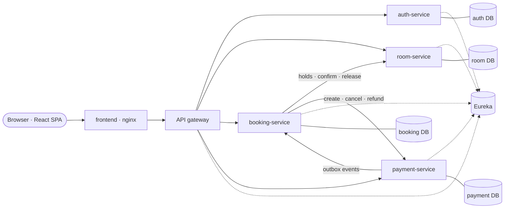
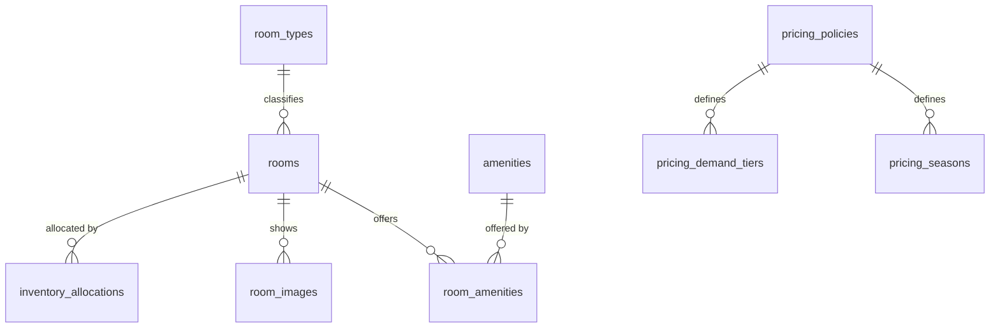
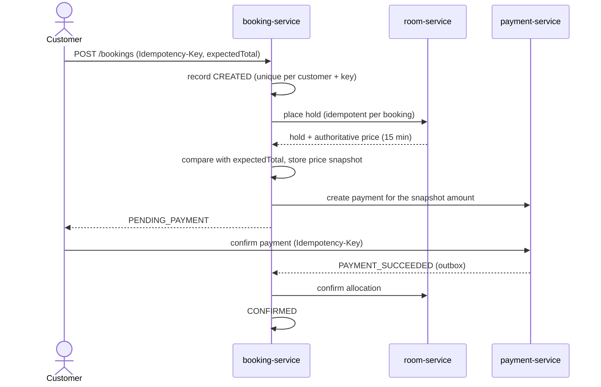

# GrandVista Hospitality: Hospitality Inventory Control and Dynamic Room Reservation Platform

**A Project Report submitted for the course SOA Programming and Microservices (24SDCS03R)**

| | |
|---|---|
| Project code | PS016 |
| Institution | K L University (Koneru Lakshmaiah Education Foundation) |
| Student name(s) | `[to be completed by the student]` |
| Register number(s) | `[to be completed]` |
| Section / batch | `[to be completed]` |
| Faculty guide | `[to be completed]` |
| Academic year | `[to be completed]` |
| Date of submission | `[to be completed]` |

> Note on this document: it describes the software as implemented and tested in the accompanying repository.
> No approvals, signatures, certificates, faculty remarks or deployment evidence are claimed. Places where the
> student must add institutional details or screenshots are marked `[to be completed]` / `[Screenshot: …]`.

---

## Declaration and certificate

`[Institution-specific declaration and certificate pages to be inserted from the official template.]`

## Acknowledgement

`[To be written by the student.]`

---

## 1. Abstract

Hotel reservation systems must keep room inventory consistent while many customers search, reserve and pay at
the same time, and while payment providers answer asynchronously or not at all. This project designs and
implements **GrandVista Hospitality**, a reservation platform for a fictional hotel, as a set of independently
deployable Spring Boot microservices behind a Spring Cloud API gateway with Eureka service discovery. A room
service owns inventory, availability and a deterministic dynamic-pricing engine; a booking service orchestrates
each reservation as a saga across the room and payment services; a payment service implements a payment state
machine over a provider abstraction with a simulated provider, signed webhooks, refunds and a transactional
outbox; an authentication service issues RS256 JSON Web Tokens with rotating refresh tokens. Double booking is
prevented by a PostgreSQL exclusion constraint over date ranges, and every remote step is idempotent so retries
and duplicate messages are harmless. A React and TypeScript web application provides the customer journey and an
administration dashboard. The system is packaged with Docker Compose. Verification comprises 148 automated
backend tests (unit, integration with real PostgreSQL via Testcontainers, contract and gateway tests), 24
frontend tests, a 52-check end-to-end test on the running stack, a live consistency audit and a load test in
which 10 simultaneous booking attempts for the same room produced exactly one reservation.

**Keywords:** microservices, service-oriented architecture, saga pattern, transactional outbox, idempotency,
dynamic pricing, Spring Cloud, Eureka, API gateway, JWT.

## 2. Introduction

Service-oriented architecture (SOA) structures a system as services that expose well-defined interfaces and can
evolve independently. Microservices refine this idea: each service owns its data, is deployed on its own and
communicates only through its published API. These properties bring flexibility but move several problems that a
single database transaction would solve — consistency, failure handling, duplicate requests — into the design of
the services themselves.

Hotel reservations are a demanding test of this style because they combine shared, scarce inventory (a room on a
given night), money, and external parties (payment providers) that are slow or unreliable. This project uses that
domain to apply the principal techniques of the course: service decomposition by business capability, API gateway
and discovery, client-side load balancing, token-based security, synchronous and asynchronous inter-service
communication, and distributed consistency without distributed transactions.

## 3. Problem statement

Design and build a platform that coordinates hotel inventory, room availability, reservation creation, payments,
authentication and administration across independently deployable services, such that:

1. a room can never be sold twice for overlapping nights, even under concurrent requests;
2. the price is calculated by the server, is explainable to the customer and does not change after booking;
3. a customer is never charged without a reservation, and a reservation is never confirmed without payment;
4. retries, duplicate messages, timeouts and temporary service outages do not corrupt state;
5. only authorised users can see or change data, and administrators cannot alter payment outcomes;
6. the whole system can be started, tested and demonstrated on a single computer.

## 4. Objectives

1. Decompose the domain into room, booking, payment and authentication services with private databases.
2. Provide a single public entry point (API gateway) with service discovery (Eureka) and load balancing.
3. Implement JWT-based authentication with user, staff and administrator roles enforced in every service.
4. Implement date-aware availability and a configurable, deterministic dynamic-pricing engine.
5. Implement the booking–payment–inventory workflow as a saga with compensating actions and recovery.
6. Guarantee inventory consistency at the database level and make all remote operations idempotent.
7. Deliver a responsive web application for customers and administrators.
8. Verify the system with layered automated tests and live end-to-end, consistency and load tests.
9. Package the system with Docker Compose and document deployment, security and operation.

## 5. Limitations of existing systems

Small hotels commonly rely on one of the following (general observations, not a survey conducted for this project):

| Approach | Limitation addressed by this project |
|---|---|
| Spreadsheets / manual registers | no real-time availability; double bookings when two staff members sell the same room |
| Monolithic booking application | one deployable unit: a pricing change redeploys payments; scaling search means scaling everything |
| Static nightly price | ignores weekends, seasons and demand; manual price edits change existing bookings |
| Check-then-insert availability logic | race conditions under concurrency produce overbooking |
| Front-end-trusted payment result | a manipulated browser request can mark a booking paid |

## 6. Proposed system

A microservices platform (Figure 1) in which each business capability is a separate Spring Boot service with its
own PostgreSQL database; the browser talks only to the API gateway; services find each other through Eureka;
the booking service coordinates the reservation saga; the payment service publishes payment outcomes through a
transactional outbox; and invariants such as "no overlapping allocations" are enforced by database constraints.

**Figure 1 — Service architecture**



## 7. Functional requirements

| ID | Requirement |
|---|---|
| F1 | Register, sign in, refresh session, sign out; roles CUSTOMER, STAFF, ADMIN |
| F2 | Browse rooms; search by dates, guests, type, price and amenities; sort and paginate |
| F3 | Check availability of a room for a stay `[check-in, check-out)` and view booked nights |
| F4 | Obtain an itemised dynamic price quote (per night, fee, tax, total) |
| F5 | Create a booking that holds the room for 15 minutes and prepares a payment |
| F6 | Pay with a (simulated) provider; see an authoritative confirmation |
| F7 | View upcoming/past bookings, booking details, status history and payment status |
| F8 | Cancel a booking with a refund calculated by a documented policy |
| F9 | Administer rooms, room types, amenities, photographs and operational status |
| F10 | Publish versioned pricing policies (weekend, seasons, demand tiers, limits, fee, tax) |
| F11 | View operational dashboards: occupancy, bookings, payments; search bookings and payments |
| F12 | Manage users' roles and account status |

## 8. Non-functional requirements

| Category | Requirement and how it is met |
|---|---|
| Consistency | no double booking under concurrency (database exclusion constraint); idempotent operations |
| Reliability | timeouts, bounded retries, outbox with backoff, recovery and reconciliation jobs |
| Security | RS256 JWT, BCrypt, lockout, rate limiting, CORS, ownership checks, input validation, secure uploads |
| Performance | indexed queries, batched loading, virtual threads; measured ≈1 100 req/s for search+quote on one laptop |
| Maintainability | small services, DTO contracts, migrations, consistent error format, shared conventions library |
| Observability | health/readiness probes, Prometheus metrics, correlation IDs in all logs, audit tables |
| Usability & accessibility | responsive layout 375–1440 px, keyboard focus styles, labels, axe-core checks |
| Portability | Docker images and Compose; environment-based configuration |

## 9. Software and hardware requirements

**Development and verification environment (actually used):** Apple Silicon Mac, 8 GB RAM, macOS; Docker 29.9
with a 4 GB VM; Java 21 (Eclipse Temurin); Maven 3.9.16; Node.js 22 and npm 10.

**Software stack:** Spring Boot 3.5.16, Spring Cloud 2025.0.3, Spring Security, Spring Data JPA (Hibernate 6),
Flyway, PostgreSQL 16, springdoc-openapi 2.8, Micrometer; React 19, TypeScript 5.9, Vite 7, React Router 7,
TanStack Query 5, React Hook Form, Zod 4, Tailwind CSS 4, Recharts 3; JUnit 5, Mockito, Testcontainers, Vitest,
Testing Library, axe-core; Docker Compose; GitHub Actions (configured).

**Minimum to run the stack:** a 64-bit machine with Docker and about 4 GB of memory available to Docker.

## 10. Technology selection and justification

| Choice | Justification |
|---|---|
| Spring Boot 3.5 + Spring Cloud 2025.0 | mature microservice ecosystem; the release trains are compatible (verified by build) |
| Spring Cloud Gateway (WebFlux) | non-blocking edge with routing, filters and Spring Security integration |
| Netflix Eureka + Spring Cloud LoadBalancer | course-standard discovery; client-side round-robin load balancing |
| PostgreSQL | range types and GiST exclusion constraints give a database-level double-booking guarantee |
| Flyway | versioned, reviewable schema; services validate the schema at start-up |
| RS256 JWT with JWKS | only the auth service can sign; services verify with a public key; supports key rotation |
| RabbitMQ + transactional outbox | durable fan-out of domain events to several consumers; the outbox makes publishing atomic with the state change |
| Mailpit + Thymeleaf | HTML e-mails rendered from templates and captured by a local SMTP server, so no real mail is sent during development |
| React + TypeScript + Vite | typed, component-based UI with fast builds and code splitting |
| Testcontainers | integration tests against the real database engine and its constraints |
| Docker Compose | reproducible multi-service environment on one machine |

## 11. System architecture

The system has six deployable backend components (gateway, discovery server, four business services), a static
frontend served by nginx, and PostgreSQL. Communication:

* **Synchronous** REST over HTTP with explicit timeouts (2 s connect, 5–8 s read) and bounded retries (3
  attempts, exponential backoff with jitter) applied only to idempotent operations.
* **Asynchronous** domain events (`BOOKING_CREATED/CONFIRMED/CANCELLED`, `HOLD_EXPIRED`, `PAYMENT_SUCCEEDED/FAILED`)
  through RabbitMQ: producers write them to a transactional outbox and publish with publisher confirms; each
  consumer (booking-service, notification-service) has a durable queue with retries and a dead-letter queue, and
  de-duplicates by event id.
* **Discovery and load balancing:** services register in Eureka; the gateway uses `lb://` routes and the booking
  and payment services use load-balanced HTTP clients. With two room-service instances, 60 gateway requests were
  served 30/30 and the booking service's internal calls 4/4 (measured).
* **Correlation:** the gateway assigns an `X-Correlation-Id` that every service logs and forwards.

Detailed diagrams (context, sequence, state machines, deployment) are in `docs/architecture/ARCHITECTURE.md`.

## 12. Microservice responsibilities

| Service | Responsibilities | Data owned |
|---|---|---|
| discovery-server | registry of service instances (HTTP Basic protected) | — |
| api-gateway | routing, token pre-validation, CORS, per-IP rate limits, size limits, uniform errors, aggregated API docs | — |
| auth-service | accounts, BCrypt passwords, lockout, JWT issuance, JWKS, rotating refresh tokens, roles, service credentials, bootstrap administrator | users, roles, refresh tokens, auth audit |
| room-service | catalogue, photographs, operational status, search, availability, holds/allocations, dynamic pricing, policy versions, occupancy, inventory audit | rooms, types, amenities, images, allocations, pricing policies, inventory events |
| booking-service | reservations, saga orchestration, price snapshots, cancellation policy, payment-event inbox, recovery of stuck bookings | bookings, guests, snapshots, history, processed events |
| payment-service | payment intents and attempts, provider abstraction (simulated provider), webhooks, refunds, reconciliation, outbox | payments, attempts, refunds, payment events, webhook receipts, outbox |

## 13. Database design

Each service owns a separate database on **its own PostgreSQL server** (one container, volume and set of credentials
per service; the service's non-superuser role does not exist on the other servers — verified by
`scripts/verify-db-isolation.sh`, 28/28 checks). Cross-service references are identifiers only. Key constraints:

* `inventory_allocations`: `EXCLUDE USING gist (room_id WITH =, stay_range WITH &&) WHERE status IN ('HELD','CONFIRMED')`
  where `stay_range = daterange(check_in, check_out, '[)')`; unique `booking_id`.
* `bookings`: unique `(customer_id, idempotency_key)`; `booking_price_snapshots.total = subtotal + fee + taxes`.
* `payments`: unique `booking_id`; `refunded_amount <= amount`; unique `(payment_id, idempotency_key)` on attempts;
  unique provider event id on webhook receipts.
* `pricing_policies`: partial unique index guaranteeing exactly one active policy.

**Figure 2 — Room-service entities (excerpt)**



Complete ER diagrams, table responsibilities, indexes and migrations: `docs/database/DATABASE.md`.

## 14. API design

REST resources under `/api/v1`, JSON bodies, RFC 9457 problem responses with a stable `code`, pagination with a
uniform envelope, and OpenAPI documentation for every service (aggregated Swagger UI at the gateway). Internal
service APIs live under `/internal/v1` and are never routed publicly. Write operations that customers may repeat
require an `Idempotency-Key`. The services contain 64 request-handler methods — 54 public and 10 internal —
documented in `docs/api/API_REFERENCE.md`, for example:

| Method | Path | Role |
|---|---|---|
| GET | `/api/v1/rooms?checkIn&checkOut&guests` | public |
| GET | `/api/v1/rooms/{id}/quote` | public |
| POST | `/api/v1/bookings` | customer |
| POST | `/api/v1/payments/{id}/confirm` | owning customer |
| POST | `/api/v1/bookings/{id}/cancel` | owner / staff / admin |
| PUT | `/api/v1/admin/rooms/{id}/status` | staff / admin |
| POST | `/api/v1/admin/pricing/policies` | admin |

## 15. Authentication and authorisation

The auth service hashes passwords with BCrypt (cost 12), locks an account for 15 minutes after five failures and
issues 15-minute RS256 access tokens containing the user id, e-mail and roles. A 256-bit refresh token is stored
only as a SHA-256 hash, rotated on every use, and sent as an HttpOnly, Secure, SameSite=Strict cookie limited to
`/api/v1/auth`; presenting an already-rotated token revokes the whole token family. The browser keeps the access
token in memory only. Every service validates the token's signature (via the public JWKS), issuer, audience and
expiry, and applies its own role and ownership rules; requests for another customer's booking return 404.
Services authenticate to each other with short-lived tokens from the OAuth 2.0 client-credentials grant. The first
administrator is created from environment variables only when none exists; registration can never assign roles.

## 16. Room inventory management

Rooms have a type, capacity, bed configuration, amenities, base nightly rate and an operational status (active,
maintenance, out of service, retired). Only active rooms are searchable and bookable. Photographs are stored
through a media-storage abstraction (local file system in development); uploads are accepted only when their
content is JPEG, PNG or WebP, up to 5 MB, with server-generated file names. Administrators change status under a
row lock; retiring a room with upcoming confirmed stays is refused. Every catalogue and inventory change is
written to an audit table.

## 17. Dynamic pricing

For each night of a stay the engine computes

```
rate = round2( clamp( base × weekend × season × demand , base × minFactor , base × maxFactor ) )
subtotal = Σ rate;  fee = round2(subtotal × feeRate);  tax = round2((subtotal + fee) × taxRate);  total = subtotal + fee + tax
```

with `BigDecimal` arithmetic and HALF_UP rounding. The demand multiplier comes from the hotel's own occupancy of
the room type that night (held plus confirmed allocations divided by sellable rooms) — no external market data is
assumed. Policies are immutable versions; publishing a new version archives the previous one, and quotes record
the version used. The policy seeded with the system applies +15% on Friday and Saturday nights, ×1.30 in a
festive season, ×1.10 at ≥ 50% and ×1.25 at ≥ 80% occupancy, a 5% service fee and 12% tax, bounded to 0.8–1.8 × the
base rate. Example (verified by a unit test): base ₹4 500 for two weekday nights → subtotal ₹9 000, fee ₹450,
tax ₹1 134, total ₹10 584.

## 18. Booking workflow



States: `CREATED → PENDING_PAYMENT → CONFIRMED → CANCELLATION_PENDING → CANCELLED`, with terminal alternatives
`REJECTED`, `PAYMENT_FAILED`, `EXPIRED` and an operational state `NEEDS_ATTENTION`. Transitions are validated by
the domain model and recorded in a history table with actor and reason. Cancellation refunds 100% when at least
seven days remain before check-in, 50% at two to six days, nothing within 48 hours, and is refused on or after the
check-in date; hotel-initiated cancellations are refunded in full.

## 19. Payment workflow

Payments follow `CREATED → PENDING → SUCCEEDED | FAILED`, `CREATED → CANCELLED` (voided when a booking expires),
and `SUCCEEDED → REFUND_PENDING → REFUNDED | PARTIALLY_REFUNDED`. Confirmation is split into two short
transactions around the provider call, so no database lock is held during network I/O. The provider's idempotency
key is the payment id, so a retried confirmation can never charge twice. The simulated provider supports immediate
approval, decline, asynchronous decisions delivered by HMAC-signed and timestamped webhooks, and "processed but
response lost" timeouts resolved by a reconciliation job. Webhooks are de-duplicated by provider event id. The
customer's request carries only a provider token — no amount and no card data — and no administrative endpoint can
change a payment's status.

## 20. Distributed consistency

* **Saga with compensation:** a failed or expired step releases the hold, voids the payment or refunds it.
* **Database-level invariants** for overlap, uniqueness and amounts.
* **Idempotency everywhere:** bookings, holds (per booking id), payments (per booking id), payment attempts,
  provider charges, refunds and events.
* **Outbox + inbox:** payment outcomes are stored atomically with the state change and applied exactly once.
* **Recovery and reconciliation jobs** drive any interrupted workflow to a final state, using database state only
  (they survive restarts) and `SKIP LOCKED` / compare-and-set transitions (safe with several instances).
* **Per-room serialisation:** holds take a row lock on the room so concurrent requests for the same room queue
  instead of deadlocking in the exclusion constraint (a deadlock was observed and fixed during development).

## 21. Testing methodology

Layered testing: unit tests for pure logic; MockMvc tests for validation and security; integration tests against
real PostgreSQL 16 with Testcontainers; gateway tests against a stub upstream with real RS256 tokens; contract tests
that check the messages exchanged between services from both sides; frontend unit, component and accessibility
tests; and live tests on the Docker stack (end-to-end, consistency audit, load test, load-balancing measurement,
browser and responsive inspection at six viewport widths).

**Measured results (21–22 October 2026):**

| Activity | Result |
|---|---|
| Backend `mvn clean verify` | 148 tests, 0 failures, 0 errors, 0 skipped |
| Frontend lint, type check, tests, build | passed; 24 tests |
| End-to-end smoke test (52 checks) | 52 passed, 0 failed (also with two room-service instances) |
| Consistency audit | passed: 10-way race → 1 booking; 5 duplicate submissions → 1 booking; back-to-back stays accepted; cancellation races never produced two active bookings; declined payment released the room; 5 concurrent payment confirmations → 1 authorisation |
| Load test (20 virtual users, 30 s, one laptop) | 33 598 requests, 1 119 req/s, p95 47 ms (search) / 32 ms (quote), 0 errors |
| Load balancing (2 instances) | 30/30 gateway requests; 4/4 internal calls |
| Responsive inspection | 375, 390, 430, 768, 1024, 1440 px — defects found and fixed (Section 25) |

Complete results and commands: `docs/testing/TESTING.md`; raw outputs: `docs/testing/evidence/`.

## 22. Deployment architecture

Seven Docker images (multi-stage builds, non-root runtime users, health checks) and four PostgreSQL servers (one per
service) run in one Compose
project on a private network. Only the web application (port 3000) and the gateway (8080) are published; Eureka and
PostgreSQL are bound to the loopback interface. Secrets come from a generated, git-ignored `.env` file and a
generated RSA key pair mounted read-only. A cloud deployment path (managed containers, managed PostgreSQL, secret
manager, HTTPS load balancer) is documented in `docs/deployment/DEPLOYMENT.md`; **no cloud deployment was
performed**.

## 23. Security considerations

Threats addressed include brute force (lockout, rate limits), token theft (in-memory access tokens, HttpOnly
refresh cookie with rotation and reuse detection), CSRF (SameSite=Strict plus a required header on the two cookie
endpoints), insecure direct object references (ownership checks returning 404), mass assignment (request DTOs),
price and payment tampering (server-side pricing, provider-only outcomes), forged callbacks (HMAC with timestamp
and de-duplication), malicious uploads (content sniffing, size limits, generated names, path checks) and secret
leakage (git-ignored generated secrets, masked logging). Residual risks — e.g. access tokens valid for up to 15
minutes after logout, in-memory rate limiting per gateway instance, the simulated provider — are listed in
`docs/security/SECURITY.md`.

## 24. Implementation summary

| Part | Size (approximate) |
|---|---|
| Backend services and shared library | 6 Spring Boot applications + 1 library (Java 21) |
| Database migrations | 5 Flyway migrations across 4 databases |
| REST handler methods | 64 (54 public, 10 internal service-to-service) |
| Frontend | about 20 client-side routes (customer and admin), typed API client, design system |
| Automated tests | 148 backend + 24 frontend |
| Scripts | environment generator, reset, end-to-end test, consistency audit, load test |

## 25. Results and screenshots

Results are summarised in Section 21. During verification the following defects were found by the tests and
fixed, which illustrates the value of the test layers:

| Found by | Defect | Fix |
|---|---|---|
| schema validation | column type mismatches between entities and migrations | migrations corrected |
| concurrency test | deadlocks between concurrent conflicting inserts into the exclusion constraint | per-room row lock, consistent lock order |
| contract test | dates serialised as arrays by the load-balanced HTTP client | client built from Spring Boot's configured builder |
| live stack | services flapping UP/DOWN in Eureka | Eureka health indicator excluded from published health |
| live browser test | 500 error on "upcoming bookings" (null date parameter in PostgreSQL) | dynamic filters rewritten with JPA Specifications + regression tests |
| responsive audit | header overflow at 768 px for administrators; admin pages wider than a phone screen; dialog not scrollable on short screens; small tap targets | breakpoints, grid sizing, positioned scroll containers, scrollable dialog, larger targets |

Screenshots (to be captured by the student from the running application; none are embedded because this report
must not contain fabricated images):

* `[Screenshot: home page with search bar]`
* `[Screenshot: search results with dynamic stay prices]`
* `[Screenshot: room details with itemised quote]`
* `[Screenshot: checkout and simulated payment page with hold countdown]`
* `[Screenshot: confirmation page — "Waiting for payment confirmation" then "Your stay is confirmed"]`
* `[Screenshot: customer dashboard and booking timeline]`
* `[Screenshot: administrator overview with occupancy and booking charts]`
* `[Screenshot: Eureka dashboard with all services UP]`
* `[Screenshot: Swagger UI at the gateway]`
* `[Screenshot: terminal output of scripts/e2e-smoke.sh and scripts/consistency-audit.mjs]`

## 26. Limitations

* Payments use a simulated provider; no real provider or real money is involved.
* The system has not been deployed to a cloud platform; the CI workflow has not been executed on GitHub.
* Gateway rate limiting is in memory (single gateway instance); Eureka and the gateway were not run in multiple
  instances.
* E-mails are captured by a local SMTP server (Mailpit); no real e-mail provider is configured. No multi-property
  or multi-currency support.
* Performance figures come from a single laptop and are not production capacity estimates.
* Responsive testing used browser emulation, not physical devices.

## 27. Future enhancements

1. Integrate a real payment provider (implementing the existing `PaymentProvider` interface and its webhook
   signature scheme).
2. Connect a real e-mail provider (SMTP relay or API) in place of Mailpit; add SMS notifications.
3. Redis-backed rate limiting and caching of catalogue reads; multiple gateway and Eureka instances.
4. Cloud deployment with managed PostgreSQL, a secret manager, HTTPS and centralised logging and tracing
   (OpenTelemetry).
5. E-mail/SMS notifications for confirmations, reminders and refunds.
6. Overbooking and room-type (rather than specific-room) inventory, multi-property support, loyalty programmes.
7. Demand forecasting from historical bookings to inform pricing policies.

## 28. Conclusion

The project shows that the guarantees a hotel needs — no double bookings, honest prices, no payment without a
reservation — can be preserved across independently deployed services by combining database-level invariants,
idempotent operations, an orchestrated saga with compensations, a transactional outbox and recovery jobs, rather
than distributed transactions. Spring Cloud provided the service infrastructure (gateway, discovery, load
balancing), and layered automated tests — especially integration tests against a real database and live tests
against the running system — found and fixed defects that unit tests alone would have missed. The resulting
platform runs end to end on a single machine and is documented for further development and deployment.

## 29. References

1. Richardson, C. *Microservices Patterns: With Examples in Java.* Manning, 2018 (saga, transactional outbox, API gateway patterns).
2. Newman, S. *Building Microservices*, 2nd ed. O'Reilly, 2021.
3. Garcia-Molina, H.; Salem, K. "Sagas." *Proceedings of the ACM SIGMOD Conference*, 1987.
4. Spring Boot Reference Documentation, version 3.5. https://docs.spring.io/spring-boot/
5. Spring Cloud Gateway and Spring Cloud Netflix (Eureka) Reference Documentation, release train 2025.0. https://spring.io/projects/spring-cloud
6. Spring Security Reference — OAuth 2.0 Resource Server (JWT). https://docs.spring.io/spring-security/reference/
7. PostgreSQL 16 Documentation — Range Types; Exclusion Constraints; `SELECT … FOR UPDATE SKIP LOCKED`. https://www.postgresql.org/docs/16/
8. IETF RFC 7519, *JSON Web Token (JWT)*, 2015; RFC 7517, *JSON Web Key (JWK)*, 2015.
9. IETF RFC 6749, *The OAuth 2.0 Authorization Framework* (client-credentials grant), 2012.
10. IETF RFC 9457, *Problem Details for HTTP APIs*, 2023.
11. OWASP Cheat Sheet Series — Authentication, Session Management, CSRF Prevention, File Upload. https://cheatsheetseries.owasp.org/
12. Testcontainers for Java documentation. https://java.testcontainers.org/
13. React and TypeScript documentation. https://react.dev/ ; https://www.typescriptlang.org/docs/
14. W3C, *Web Content Accessibility Guidelines (WCAG) 2.2*, 2023.
