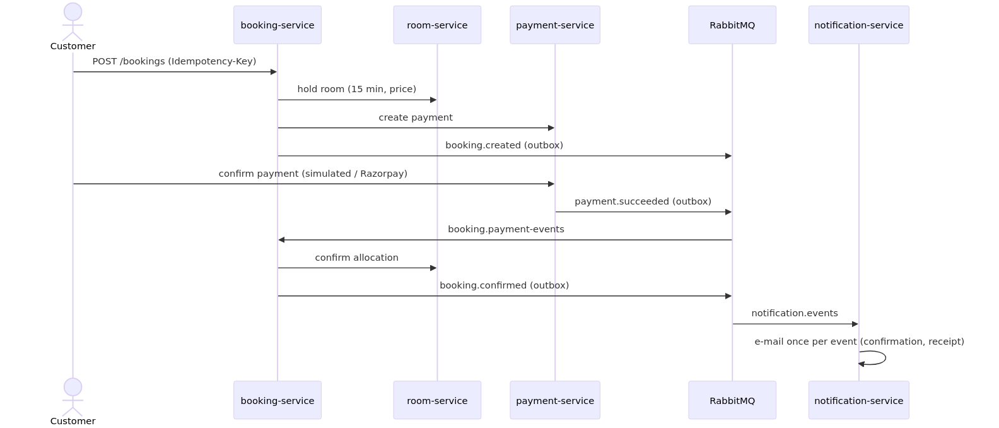
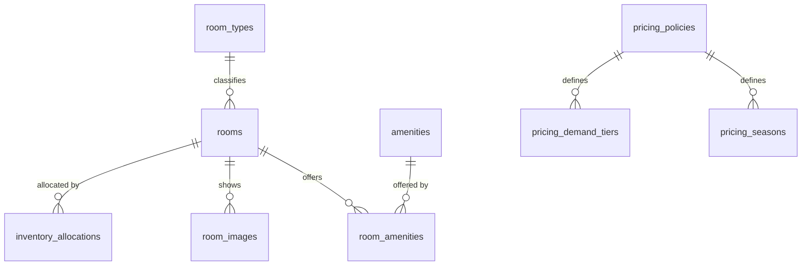
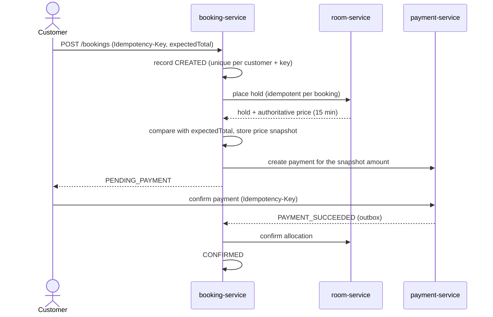

# GrandVista Hospitality: Hospitality Inventory Control and Dynamic Room Reservation Platform

**A Project Report submitted for the course SOA Programming and Microservices (24SDCS03R)**

| | |
|---|---|
| Project code | PS016 |
| Institution | K L University (Koneru Lakshmaiah Education Foundation) |
| Student name(s) | `[to be completed by the student]` |
| Register number(s) | `[to be completed]` |
| Department | `[to be completed]` |
| Section / batch | `[to be completed]` |
| Faculty guide | `[to be completed]` |
| Academic year | `[to be completed]` |
| Date of submission | `[to be completed]` |

> Note on this document: it describes the software as implemented and tested in the accompanying repository.
> No approvals, signatures, certificates, faculty remarks or deployment evidence are claimed. Places where the
> student must add institutional details or screenshots are marked `[to be completed]` / `[Screenshot: …]`.

---

## Declaration and certificate

`[Institution-specific declaration and certificate pages to be inserted from the official template.]`

## Acknowledgement

`[To be written by the student.]`

---

## 1. Abstract

Hotel reservation systems must keep room inventory consistent while many customers search, reserve and pay at
the same time, and while payment providers answer asynchronously or not at all. This project designs and
implements **GrandVista Hospitality**, a reservation platform for a fictional hotel, as a set of independently
deployable Spring Boot microservices behind a Spring Cloud API gateway with Eureka service discovery. A room
service owns inventory, availability and a deterministic dynamic-pricing engine; a booking service orchestrates
each reservation as a saga across the room and payment services; a payment service implements a payment state
machine over a gateway abstraction (a simulated provider and a Razorpay test-mode gateway), signed webhooks,
refunds and a transactional outbox; a notification service turns domain events received over RabbitMQ into HTML
e-mails; an authentication service issues RS256 JSON Web Tokens with rotating refresh tokens. Each service owns a
separate PostgreSQL server. Double booking is prevented by a PostgreSQL exclusion constraint over date ranges, and
every remote step is idempotent so retries and duplicate messages are harmless. Eureka, the gateway and the
booking service run as two instances each, protected by Resilience4j circuit breakers and retries. A React and
TypeScript web application provides the customer journey and an administration dashboard. The system is packaged
with Docker Compose (23 containers). Verification comprises 196 automated backend tests (86.4 % line coverage)
using real PostgreSQL, RabbitMQ and Mailpit through Testcontainers, 29 frontend tests, a 56-check end-to-end test
on the running stack, a failover test that kills a gateway, a Eureka server and a booking replica, and a k6 load
test in which 10 simultaneous booking attempts for the same room produced exactly one reservation.

**Keywords:** microservices, service-oriented architecture, saga pattern, transactional outbox, message broker,
idempotency, high availability, circuit breaker, dynamic pricing, Spring Cloud, Eureka, API gateway, JWT.

## 2. Introduction

Service-oriented architecture (SOA) structures a system as services that expose well-defined interfaces and can
evolve independently. Microservices refine this idea: each service owns its data, is deployed on its own and
communicates only through its published API. These properties bring flexibility but move several problems that a
single database transaction would solve — consistency, failure handling, duplicate requests — into the design of
the services themselves.

Hotel reservations are a demanding test of this style because they combine shared, scarce inventory (a room on a
given night), money, and external parties (payment providers) that are slow or unreliable. This project uses that
domain to apply the principal techniques of the course: service decomposition by business capability, API gateway
and discovery, client-side load balancing, token-based security, synchronous and asynchronous inter-service
communication, and distributed consistency without distributed transactions.

## 3. Problem statement

Design and build a platform that coordinates hotel inventory, room availability, reservation creation, payments,
authentication and administration across independently deployable services, such that:

1. a room can never be sold twice for overlapping nights, even under concurrent requests;
2. the price is calculated by the server, is explainable to the customer and does not change after booking;
3. a customer is never charged without a reservation, and a reservation is never confirmed without payment;
4. retries, duplicate messages, timeouts and temporary service outages do not corrupt state;
5. only authorised users can see or change data, and administrators cannot alter payment outcomes;
6. the whole system can be started, tested and demonstrated on a single computer.

## 4. Objectives

1. Decompose the domain into room, booking, payment and authentication services with private databases.
2. Provide a single public entry point (API gateway) with service discovery (Eureka) and load balancing.
3. Implement JWT-based authentication with user, staff and administrator roles enforced in every service.
4. Implement date-aware availability and a configurable, deterministic dynamic-pricing engine.
5. Implement the booking–payment–inventory workflow as a saga with compensating actions and recovery.
6. Guarantee inventory consistency at the database level and make all remote operations idempotent.
7. Deliver a responsive web application for customers and administrators.
8. Verify the system with layered automated tests and live end-to-end, consistency and load tests.
9. Package the system with Docker Compose and document deployment, security and operation.
10. Deliver domain events through a message broker and notify customers by e-mail without duplicates.
11. Keep the system available when one instance of the gateway, the discovery server or the booking service fails.

## 5. Limitations of existing systems

Small hotels commonly rely on one of the following (general observations, not a survey conducted for this project):

| Approach | Limitation addressed by this project |
|---|---|
| Spreadsheets / manual registers | no real-time availability; double bookings when two staff members sell the same room |
| Monolithic booking application | one deployable unit: a pricing change redeploys payments; scaling search means scaling everything |
| Static nightly price | ignores weekends, seasons and demand; manual price edits change existing bookings |
| Check-then-insert availability logic | race conditions under concurrency produce overbooking |
| Front-end-trusted payment result | a manipulated browser request can mark a booking paid |

## 6. Proposed system

A microservices platform (Figure 1) in which each business capability is a separate Spring Boot service with its
own PostgreSQL server; browsers and API clients reach two API gateway instances through nginx load balancers;
services find each other through two replicated Eureka servers; the booking service coordinates the reservation
saga; booking and payment events travel through RabbitMQ from transactional outboxes; a notification service
e-mails customers; and invariants such as "no overlapping allocations" are enforced by database constraints.


*Figure 1 — Service architecture (source: `docs/diagrams/architecture.mmd`, rendered with Mermaid CLI 11.4.2).*



*Figure 2 — Booking, payment and e-mail event flow (`docs/diagrams/event-flow.mmd`).*

The Mermaid source of the earlier, simpler view is kept below for reference.

**Figure 1a — Core services (Mermaid source)**

**Figure 1 — Service architecture**


## 7. Functional requirements

| ID | Requirement |
|---|---|
| F1 | Register, sign in, refresh session, sign out; roles CUSTOMER, STAFF, ADMIN |
| F2 | Browse rooms; search by dates, guests, type, price and amenities; sort and paginate |
| F3 | Check availability of a room for a stay `[check-in, check-out)` and view booked nights |
| F4 | Obtain an itemised dynamic price quote (per night, fee, tax, total) |
| F5 | Create a booking that holds the room for 15 minutes and prepares a payment |
| F6 | Pay with the simulated provider or Razorpay test mode; see an authoritative confirmation |
| F7 | View upcoming/past bookings, booking details, status history and payment status |
| F8 | Cancel a booking with a refund calculated by a documented policy |
| F9 | Administer rooms, room types, amenities, photographs and operational status |
| F10 | Publish versioned pricing policies (weekend, seasons, demand tiers, limits, fee, tax) |
| F11 | View operational dashboards: occupancy, bookings, payments; search bookings and payments |
| F12 | Manage users' roles and account status |
| F13 | Receive e-mails: booking confirmation, payment receipt, cancellation, failed payment, expired hold |

## 8. Non-functional requirements

| Category | Requirement and how it is met |
|---|---|
| Consistency | no double booking under concurrency (database exclusion constraint); idempotent operations |
| Reliability & availability | timeouts, retries, circuit breakers (Resilience4j), outboxes with backoff, dead-letter queues, recovery and reconciliation jobs; 2 Eureka, 2 gateways, 2 booking replicas |
| Security | RS256 JWT, BCrypt, lockout, rate limiting, CORS, ownership checks, input validation, secure uploads |
| Performance | indexed queries, batched loading, virtual threads; k6 on one laptop: search p95 135.9 ms, quote p95 60.8 ms at 20 virtual users |
| Maintainability | small services, DTO contracts, migrations, consistent error format, shared conventions library |
| Observability | health/readiness probes, Prometheus metrics and optional Grafana dashboard, correlation IDs in logs and messages, audit tables |
| Usability & accessibility | responsive layout 375–1440 px, keyboard focus styles, labels, axe-core checks |
| Portability | Docker images and Compose; environment-based configuration |

## 9. Software and hardware requirements

**Development and verification environment (actually used):** Apple Silicon Mac, 8 GB RAM, macOS; Docker 29.9
with a 4 GB VM (the full stack used about 3 GB); Java 21 (Eclipse Temurin); Maven 3.9.16; Node.js 22 and npm 10.

**Software stack:** Spring Boot 3.5.16, Spring Cloud 2025.0.3, Spring Security, Spring Data JPA (Hibernate 6),
Flyway, PostgreSQL 16, RabbitMQ 4.1 (Spring AMQP), Resilience4j 2.2, Thymeleaf, Mailpit 1.27, springdoc-openapi
2.8, Micrometer, Prometheus 3.5 and Grafana 12.1 (optional), Caddy 2.10 (production overlay), nginx 1.27; React 19, TypeScript 5.9, Vite 7, React Router 7,
TanStack Query 5, React Hook Form, Zod 4, Tailwind CSS 4, Recharts 3; JUnit 5, Mockito, Testcontainers, Vitest,
Testing Library, axe-core, JaCoCo 0.8.13, k6 1.1; Docker Compose; GitHub Actions (configured).

**Minimum to run the stack:** a 64-bit machine with Docker and about 4 GB of memory available to Docker (measured
use ≈ 3 GB for 23 containers).

## 10. Technology selection and justification

| Choice | Justification |
|---|---|
| Spring Boot 3.5 + Spring Cloud 2025.0 | mature microservice ecosystem; the release trains are compatible (verified by build) |
| Spring Cloud Gateway (WebFlux) | non-blocking edge with routing, filters and Spring Security integration |
| Netflix Eureka + Spring Cloud LoadBalancer | course-standard discovery; client-side round-robin load balancing |
| PostgreSQL | range types and GiST exclusion constraints give a database-level double-booking guarantee |
| Flyway | versioned, reviewable schema; services validate the schema at start-up |
| RS256 JWT with JWKS | only the auth service can sign; services verify with a public key; supports key rotation |
| RabbitMQ + transactional outbox | durable fan-out of domain events to several consumers; the outbox makes publishing atomic with the state change |
| Mailpit + Thymeleaf | HTML e-mails rendered from templates and captured by a local SMTP server, so no real mail is sent during development |
| React + TypeScript + Vite | typed, component-based UI with fast builds and code splitting |
| Resilience4j | circuit breakers and retries for the gateway routes and service-to-service calls |
| Testcontainers | integration tests against the real database engine, broker and SMTP server |
| nginx + Caddy | load balancing in front of the gateways; automatic HTTPS for the production overlay |
| Docker Compose | reproducible multi-service environment on one machine |

## 11. System architecture

The system has seven Spring Boot applications (gateway, discovery server, five business services) deployed as
11 containers (two Eureka servers, two gateways, two booking replicas), a static frontend and a gateway load
balancer served by nginx, RabbitMQ, Mailpit and five PostgreSQL servers — 23 containers in total. Communication:

* **Synchronous** REST over HTTP with explicit timeouts (gateway connect 1 s / response 15 s; booking → room and
  payment connect 2 s, read 5–8 s), Resilience4j retries (3 attempts, exponential backoff with jitter, transient
  failures only) and circuit breakers.
* **Asynchronous** domain events (`BOOKING_CREATED/CONFIRMED/CANCELLED`, `HOLD_EXPIRED`, `PAYMENT_SUCCEEDED/FAILED`)
  through RabbitMQ: producers write them to a transactional outbox and publish with publisher confirms; each
  consumer (booking-service, notification-service) has a durable queue with retries and a dead-letter queue, and
  de-duplicates by event id.
* **Discovery and load balancing:** services register in both Eureka servers; the gateways use `lb://` routes and
  the booking service uses load-balanced HTTP clients; nginx balances requests across the two gateways (measured
  15/15 per gateway in the failover baseline).
* **Correlation:** the gateway assigns an `X-Correlation-Id` that every service logs and forwards.

Detailed diagrams (context, sequence, state machines, deployment) are in `docs/architecture/ARCHITECTURE.md`.

## 12. Microservice responsibilities

| Service | Responsibilities | Data owned |
|---|---|---|
| discovery-server (×2, peers) | replicated registry of service instances (HTTP Basic protected) | — |
| api-gateway (×2) + gateway-lb | routing, token pre-validation, CORS, per-IP rate limits, size limits, circuit breakers with fallback, connect-failure retry, uniform errors, aggregated API docs | — |
| auth-service | accounts, BCrypt passwords, lockout, JWT issuance, JWKS, rotating refresh tokens, roles, service credentials, bootstrap administrator | users, roles, refresh tokens, auth audit |
| room-service | catalogue, photographs, operational status, search, availability, holds/allocations, dynamic pricing, policy versions, occupancy, inventory audit | rooms, types, amenities, images, allocations, pricing policies, inventory events |
| booking-service (×2) | reservations, saga orchestration, price snapshots, cancellation policy, payment-event consumer (RabbitMQ) with inbox, booking-event outbox, recovery of stuck bookings | bookings, guests, snapshots, history, processed events, outbox |
| payment-service | payment intents and attempts, gateway abstraction (simulated, Razorpay test mode), webhooks, refunds, reconciliation, outbox | payments, attempts, refunds, payment events, webhook receipts, outbox |
| notification-service | consumes booking/payment events, booking-contact read model, Thymeleaf e-mails without duplicates, staff list of sent e-mails | booking contacts, notifications |

## 13. Database design

Each service owns a separate database on **its own PostgreSQL server** (one container, volume and set of credentials
per service; the service's non-superuser role does not exist on the other servers — verified by
`scripts/verify-db-isolation.sh`, 28/28 checks). Cross-service references are identifiers only. Key constraints:

* `inventory_allocations`: `EXCLUDE USING gist (room_id WITH =, stay_range WITH &&) WHERE status IN ('HELD','CONFIRMED')`
  where `stay_range = daterange(check_in, check_out, '[)')`; unique `booking_id`.
* `bookings`: unique `(customer_id, idempotency_key)`; `booking_price_snapshots.total = subtotal + fee + taxes`.
* `payments`: unique `booking_id`; `refunded_amount <= amount`; unique `(payment_id, idempotency_key)` on attempts;
  unique provider event id on webhook receipts.
* `pricing_policies`: partial unique index guaranteeing exactly one active policy.

**Figure 2 — Room-service entities (excerpt)**



Complete ER diagrams, table responsibilities, indexes and migrations: `docs/database/DATABASE.md`.

## 14. API design

REST resources under `/api/v1`, JSON bodies, RFC 9457 problem responses with a stable `code`, pagination with a
uniform envelope, and OpenAPI documentation for every service (aggregated Swagger UI at the gateway). Internal
service APIs live under `/internal/v1` and are never routed publicly. Write operations that customers may repeat
require an `Idempotency-Key`. The services contain 64 request-handler methods — 54 public and 10 internal —
documented in `docs/api/API_REFERENCE.md`, for example:

| Method | Path | Role |
|---|---|---|
| GET | `/api/v1/rooms?checkIn&checkOut&guests` | public |
| GET | `/api/v1/rooms/{id}/quote` | public |
| POST | `/api/v1/bookings` | customer |
| POST | `/api/v1/payments/{id}/confirm` | owning customer |
| POST | `/api/v1/bookings/{id}/cancel` | owner / staff / admin |
| PUT | `/api/v1/admin/rooms/{id}/status` | staff / admin |
| POST | `/api/v1/admin/pricing/policies` | admin |

## 15. Authentication and authorisation

The auth service hashes passwords with BCrypt (cost 12), locks an account for 15 minutes after five failures and
issues 15-minute RS256 access tokens containing the user id, e-mail and roles. A 256-bit refresh token is stored
only as a SHA-256 hash, rotated on every use, and sent as an HttpOnly, Secure, SameSite=Strict cookie limited to
`/api/v1/auth`; presenting an already-rotated token revokes the whole token family. The browser keeps the access
token in memory only. Every service validates the token's signature (via the public JWKS), issuer, audience and
expiry, and applies its own role and ownership rules; requests for another customer's booking return 404.
Services authenticate to each other with short-lived tokens from the OAuth 2.0 client-credentials grant. The first
administrator is created from environment variables only when none exists; registration can never assign roles.

## 16. Room inventory management

Rooms have a type, capacity, bed configuration, amenities, base nightly rate and an operational status (active,
maintenance, out of service, retired). Only active rooms are searchable and bookable. Photographs are stored
through a media-storage abstraction (local file system in development); uploads are accepted only when their
content is JPEG, PNG or WebP, up to 5 MB, with server-generated file names. Administrators change status under a
row lock; retiring a room with upcoming confirmed stays is refused. Every catalogue and inventory change is
written to an audit table.

## 17. Dynamic pricing

For each night of a stay the engine computes

```
rate = round2( clamp( base × weekend × season × demand , base × minFactor , base × maxFactor ) )
subtotal = Σ rate;  fee = round2(subtotal × feeRate);  tax = round2((subtotal + fee) × taxRate);  total = subtotal + fee + tax
```

with `BigDecimal` arithmetic and HALF_UP rounding. The demand multiplier comes from the hotel's own occupancy of
the room type that night (held plus confirmed allocations divided by sellable rooms) — no external market data is
assumed. Policies are immutable versions; publishing a new version archives the previous one, and quotes record
the version used. The policy seeded with the system applies +15% on Friday and Saturday nights, ×1.30 in a
festive season, ×1.10 at ≥ 50% and ×1.25 at ≥ 80% occupancy, a 5% service fee and 12% tax, bounded to 0.8–1.8 × the
base rate. Example (verified by a unit test): base ₹4 500 for two weekday nights → subtotal ₹9 000, fee ₹450,
tax ₹1 134, total ₹10 584.

## 18. Booking workflow



States: `CREATED → PENDING_PAYMENT → CONFIRMED → CANCELLATION_PENDING → CANCELLED`, with terminal alternatives
`REJECTED`, `PAYMENT_FAILED`, `EXPIRED` and an operational state `NEEDS_ATTENTION`. Transitions are validated by
the domain model and recorded in a history table with actor and reason. Cancellation refunds 100% when at least
seven days remain before check-in, 50% at two to six days, nothing within 48 hours, and is refused on or after the
check-in date; hotel-initiated cancellations are refunded in full.

## 19. Payment workflow

Payments follow `CREATED → PENDING → SUCCEEDED | FAILED`, `CREATED → CANCELLED` (voided when a booking expires),
and `SUCCEEDED → REFUND_PENDING → REFUNDED | PARTIALLY_REFUNDED`. Confirmation is split into two short
transactions around the provider call, so no database lock is held during network I/O. The provider's idempotency
key is the payment id, so a retried confirmation can never charge twice. The simulated provider supports immediate
approval, decline, asynchronous decisions delivered by HMAC-signed and timestamped webhooks, and "processed but
response lost" timeouts resolved by a reconciliation job. Webhooks are de-duplicated by provider event id. The
customer's request carries only a provider token — no amount and no card data — and no administrative endpoint can
change a payment's status.

A second gateway implementation targets **Razorpay test mode** (selected with `GV_PAYMENT_PROVIDER=razorpay`). The
server creates a Razorpay order for the exact amount in paise once per payment; the browser pays in Razorpay
Checkout and returns the payment id, order id and signature; the server verifies
`HMAC-SHA256(order_id | payment_id, key_secret)` and then fetches the payment from Razorpay, checks order, amount
and currency, and captures it if it is only authorised. Signed webhooks (`payment.captured`, `order.paid`) confirm
payments whose browser closed, and a capture that arrives for a payment already voided is refunded automatically.
This path is verified with automated tests against a fake Razorpay API; it was not run against Razorpay's real
test API because no test keys were available.

## 20. Distributed consistency

* **Saga with compensation:** a failed or expired step releases the hold, voids the payment or refunds it.
* **Database-level invariants** for overlap, uniqueness and amounts.
* **Idempotency everywhere:** bookings, holds (per booking id), payments (per booking id), payment attempts,
  provider charges, refunds and events.
* **Outbox + inbox:** booking and payment events are stored atomically with the state change, published to
  RabbitMQ with publisher confirms, and applied once by idempotent consumers (inbox table; unique
  `(event_id, notification_type)` for e-mails). Failed messages are retried with backoff and then moved to a
  dead-letter queue.
* **Recovery and reconciliation jobs** drive any interrupted workflow to a final state, using database state only
  (they survive restarts) and `SKIP LOCKED` / compare-and-set transitions (safe with several instances — the
  booking service runs as two replicas).
* **Per-room serialisation:** holds take a row lock on the room so concurrent requests for the same room queue
  instead of deadlocking in the exclusion constraint (a deadlock was observed and fixed during development).

## 21. Testing methodology

Layered testing: unit tests for pure logic; MockMvc tests for validation and security; integration tests against
real PostgreSQL 16, RabbitMQ 4.1 and Mailpit with Testcontainers; gateway tests against a stub upstream with real
RS256 tokens; contract tests that check the messages exchanged between services from both sides (including the
RabbitMQ events); Razorpay tests against a fake Razorpay API; frontend unit, component and accessibility tests;
and live tests on the Docker stack (end-to-end, consistency audit, failover, k6 load test, browser and responsive
inspection). Code coverage is measured with JaCoCo.

**Measured results (21–22 October 2026, one Apple Silicon laptop):**

| Activity | Result |
|---|---|
| Backend `mvn -B clean verify` | **196 tests, 0 failures, 0 errors, 0 skipped** |
| Code coverage (JaCoCo aggregate) | **86.4 % of lines (3 871 / 4 479), 65.8 % of branches (952 / 1 447)** |
| Frontend lint, type check, tests, build | passed; **29 tests** (incl. axe accessibility checks) |
| End-to-end smoke test | **56/56** checks (incl. 4 e-mails verified in Mailpit), on the high-availability stack |
| Database isolation check | 40/40 (five PostgreSQL servers, no cross-service roles) |
| Failover (kill one gateway, one Eureka, one booking replica) | run A 99/100 requests + 4/4 bookings; run B 100/100 + 4/4 |
| k6 load test (ramp to 20 virtual users, 55 s, 0.2 s think time) | 7 275 requests (120.9 req/s), 0 % errors; search median 17.6 ms / p95 135.9 ms; quote median 10.6 ms / p95 60.8 ms |
| Contention (k6: 10 customers book the same room at once) | **1 accepted, 9 refused (409)**, 0 unexpected |
| Consistency audit (earlier phase) | 10-way race → 1 booking; duplicate submissions → 1 booking; 5 concurrent payment confirmations → 1 authorisation |
| Production overlay over HTTPS (local, `GV_DOMAIN=localhost`) | smoke test 52/52 (e-mail checks skipped) |
| Responsive inspection | 375, 390, 430, 768, 1024, 1440 px (Chromium emulation); payment page re-checked at 375 px after Phase 3 |

An earlier load test with a Node.js script and no think time measured 1 119 req/s (search + quote, one gateway);
the k6 figures above use think time and two gateways and are therefore not comparable throughput maxima. Complete
results and commands: `docs/testing/TESTING.md`; raw outputs: `docs/testing/evidence/`.

## 22. Deployment architecture

Seven Docker images (multi-stage builds, non-root runtime users, health checks) run as 23 containers in one Compose
project on a private network: two Eureka servers, two gateways behind an nginx load balancer, auth, room, two
booking replicas, payment and notification services, five PostgreSQL servers (one per service), RabbitMQ, Mailpit
and the web application. Only the web application (3000) and the load balancer (8080) are published; databases,
RabbitMQ, Mailpit and Eureka are bound to the loopback interface. Secrets come from a generated, git-ignored `.env`
file and a generated RSA key pair mounted read-only. Java memory settings were tuned (heap 60 % of a 448 MiB limit,
metaspace/code-cache caps, `MALLOC_ARENA_MAX=2`) so that the stack fits in about 3 GB.

**High availability.** Two Eureka servers replicate their registries to each other; two API gateway instances run
behind an nginx load balancer (and the web server's own upstream); the booking service runs as two replicas.
Resilience4j circuit breakers protect the gateway's routes (with a fallback answer `503` + `Retry-After`) and the
booking service's calls to the room and payment services (with retries limited to transient failures). The
failover script `scripts/failover-demo.sh` kills (SIGKILL) one gateway, one Eureka server and one booking replica in
turn while sending requests and making complete bookings. Two recorded runs: 99 of 100 and 100 of 100 requests
succeeded, and all 8 bookings completed (`docs/testing/evidence/failover-demo.txt`). The single failure was a request
already in flight to the gateway at the moment it was killed.

**Cloud.** A production overlay (`docker-compose.prod.yml`) publishes only Caddy (ports 80/443, automatic Let's
Encrypt certificates, HSTS) and switches the services to the `prod` profile; `scripts/deploy.sh` deploys and
smoke-tests it on a single VM. The recommended free target is an Oracle Cloud Always Free ARM VM (4 OCPU, 24 GB).
The overlay was tested locally over HTTPS; **no cloud deployment was performed** (no cloud account was available).

**CI.** A GitHub Actions workflow builds and tests the backend with coverage, checks the frontend, builds the images,
starts the full stack and runs the smoke test. **It has not yet run on GitHub** (no repository was configured).

## 23. Security considerations

Threats addressed include brute force (lockout, rate limits), token theft (in-memory access tokens, HttpOnly
refresh cookie with rotation and reuse detection), CSRF (SameSite=Strict plus a required header on the two cookie
endpoints), insecure direct object references (ownership checks returning 404), mass assignment (request DTOs),
price and payment tampering (server-side pricing, provider-only outcomes; Razorpay results are signature-checked
and then verified with Razorpay's API), forged callbacks (HMAC signatures, timestamps, de-duplication), malicious
uploads (content sniffing, size limits, generated names, path checks) and secret leakage (git-ignored generated
secrets, masked logging; live Razorpay keys refused). A validation review found and fixed one defect: an empty
request body to the account-status endpoint used to disable the account. Residual risks — e.g. access tokens valid
for up to 15 minutes after logout, per-instance rate limiting — are listed in `docs/security/SECURITY.md`.

## 24. Implementation summary

| Part | Size |
|---|---|
| Backend | 7 Spring Boot applications (gateway, discovery, auth, room, booking, payment, notification) + 1 shared library, Java 21 |
| Database migrations | 8 Flyway migrations across 5 databases |
| REST handler methods | 67 (57 public, 10 internal service-to-service) |
| Domain events | 6 event types on RabbitMQ, 2 consumer queues with dead-letter queues |
| Frontend | 13 page modules plus the administration area (about 20 client-side routes), typed API client, design system |
| Automated tests | 196 backend + 29 frontend |
| Scripts | environment generator, reset, end-to-end test, DB isolation check, failover demo, consistency audit, Node and k6 load tests, coverage summary, deploy |
| Containers | 23 (25 with the optional Prometheus/Grafana profile) |

## 25. Results and screenshots

Results are summarised in Section 21. During verification the following defects were found by the tests and
fixed, which illustrates the value of the test layers:

| Found by | Defect | Fix |
|---|---|---|
| schema validation | column type mismatches between entities and migrations | migrations corrected |
| concurrency test | deadlocks between concurrent conflicting inserts into the exclusion constraint | per-room row lock, consistent lock order |
| contract test | dates serialised as arrays by the load-balanced HTTP client | client built from Spring Boot's configured builder |
| live stack | services flapping UP/DOWN in Eureka | Eureka health indicator excluded from published health |
| live browser test | 500 error on "upcoming bookings" (null date parameter in PostgreSQL) | dynamic filters rewritten with JPA Specifications + regression tests |
| responsive audit | header overflow at 768 px for administrators; admin pages wider than a phone screen; dialog not scrollable on short screens; small tap targets | breakpoints, grid sizing, positioned scroll containers, scrollable dialog, larger targets |
| fresh-start smoke test | checks failed while Eureka was still propagating instances | smoke test waits until every service is routable |
| RabbitMQ integration test | duplicate events processed concurrently call the (idempotent) room confirm twice | documented and asserted: one transition, one event |
| Razorpay integration test | webhook path blocked by the payment-service security rules | path allowed; signature verified in the handler |
| failover demo | request to a killed booking replica failed (`NoRouteToHostException` not retried); 2 s penalty per request until eviction | connect-failure retry extended; 1 s connect timeout; faster Eureka eviction |
| validation review | empty status body disabled a user account | field required |
| production overlay test | `/internal/*` answered by the web app instead of 404 | Caddy returns 404 |

Screenshots — to be captured by the student from the running application (none are embedded, so that the report
contains no fabricated images). The numbers match the capture guide in `docs/DEMO_SCRIPT.md`:

* `[Screenshot 1: home page with search bar]`
* `[Screenshot 2: search results with dynamic stay prices]`
* `[Screenshot 3: room details with itemised price quote]`
* `[Screenshot 4: payment page with hold countdown and test payment methods]`
* `[Screenshot 5: confirmation page — "Your stay is confirmed"]`
* `[Screenshot 6: confirmation e-mail and payment receipt in Mailpit]`
* `[Screenshot 7: customer dashboard and booking timeline]`
* `[Screenshot 8: administrator overview with occupancy and booking charts]`
* `[Screenshot 9: Eureka dashboards (8761 and 8762) with all services and two instances of gateway and booking]`
* `[Screenshot 10: RabbitMQ management UI — queues with consumers and empty dead-letter queues]`
* `[Screenshot 11: terminal output of scripts/failover-demo.sh (summary table)]`
* `[Screenshot 12: Grafana "GrandVista — service overview" dashboard]`
* `[Screenshot 13: Swagger UI at the gateway]`
* `[Screenshot 14: GitHub Actions run with all jobs green and the README badge]` *(only after CI has run)*

## 26. Limitations and future work

**Still simulated or not done (as of 22 October 2026):**

* **Payments:** the simulated provider is the default. The Razorpay test-mode gateway is implemented and tested
  against a fake Razorpay API but has **not** been run against Razorpay's real test API (no keys). No live payments.
* **Cloud:** **not deployed**; the production overlay was tested only on the development machine.
* **CI:** the workflow has **not** run on GitHub (no repository configured), so there is no CI badge yet.
* **E-mail:** captured locally by Mailpit; no real e-mail provider.
* **Availability:** Eureka, gateways and booking run twice; auth, room, payment, notification, RabbitMQ and each
  PostgreSQL server run once. Rate limits are per gateway instance (a client can reach twice the limit).
* **Evidence:** performance figures come from one laptop; responsive checks used browser emulation, not phones;
  e-mails, failover and load tests ran locally.

**Future work:**

1. Run the Razorpay flow against Razorpay's test API, then the e2e test in Razorpay mode.
2. Deploy to the recommended VM and run the CI workflow on GitHub; add continuous deployment over SSH.
3. Real e-mail provider (SMTP relay or API) and SMS notifications; reminders before check-in.
4. Redis-backed rate limiting shared by the gateways; replicas of the remaining services; RabbitMQ quorum queues;
   PostgreSQL replication and automated backups.
5. Distributed tracing (OpenTelemetry) alongside the existing correlation IDs.
6. Room-type inventory with overbooking control, multi-property support, demand forecasting for pricing.

## 27. Conclusion

The project shows that the guarantees a hotel needs — no double bookings, honest prices, no payment without a
reservation — can be preserved across independently deployed services by combining database-level invariants,
idempotent operations, an orchestrated saga with compensations, transactional outboxes with a message broker and
recovery jobs, rather than distributed transactions. Spring Cloud provided the service infrastructure (gateway,
discovery, load balancing), Resilience4j and replicated instances kept the system answering when a gateway, a
Eureka server or a booking replica was killed, and layered automated tests — especially integration tests against
a real database, broker and SMTP server and live tests against the running system — found and fixed defects that
unit tests alone would have missed. The resulting platform runs end to end on a single machine and is prepared for
deployment to a free cloud VM.

## 28. References

1. Richardson, C. *Microservices Patterns: With Examples in Java.* Manning, 2018 (saga, transactional outbox, API gateway patterns).
2. Newman, S. *Building Microservices*, 2nd ed. O'Reilly, 2021.
3. Garcia-Molina, H.; Salem, K. "Sagas." *Proceedings of the ACM SIGMOD Conference*, 1987.
4. Spring Boot Reference Documentation, version 3.5. https://docs.spring.io/spring-boot/
5. Spring Cloud Gateway and Spring Cloud Netflix (Eureka) Reference Documentation, release train 2025.0. https://spring.io/projects/spring-cloud
6. Spring Security Reference — OAuth 2.0 Resource Server (JWT). https://docs.spring.io/spring-security/reference/
7. PostgreSQL 16 Documentation — Range Types; Exclusion Constraints; `SELECT … FOR UPDATE SKIP LOCKED`. https://www.postgresql.org/docs/16/
8. IETF RFC 7519, *JSON Web Token (JWT)*, 2015; RFC 7517, *JSON Web Key (JWK)*, 2015.
9. IETF RFC 6749, *The OAuth 2.0 Authorization Framework* (client-credentials grant), 2012.
10. IETF RFC 9457, *Problem Details for HTTP APIs*, 2023 (obsoletes RFC 7807).
11. RabbitMQ Documentation — Publisher Confirms; Dead Letter Exchanges. https://www.rabbitmq.com/docs/
12. Resilience4j Documentation — CircuitBreaker, Retry. https://resilience4j.readme.io/
13. Razorpay Documentation — Orders API, Payment signature verification, Webhooks (test mode). https://razorpay.com/docs/
14. Hohpe, G.; Woolf, B. *Enterprise Integration Patterns.* Addison-Wesley, 2003 (idempotent receiver, dead letter channel).
15. OWASP Cheat Sheet Series — Authentication, Session Management, CSRF Prevention, File Upload. https://cheatsheetseries.owasp.org/
16. Testcontainers for Java documentation. https://java.testcontainers.org/
17. React and TypeScript documentation. https://react.dev/ ; https://www.typescriptlang.org/docs/
18. W3C, *Web Content Accessibility Guidelines (WCAG) 2.2*, 2023.
